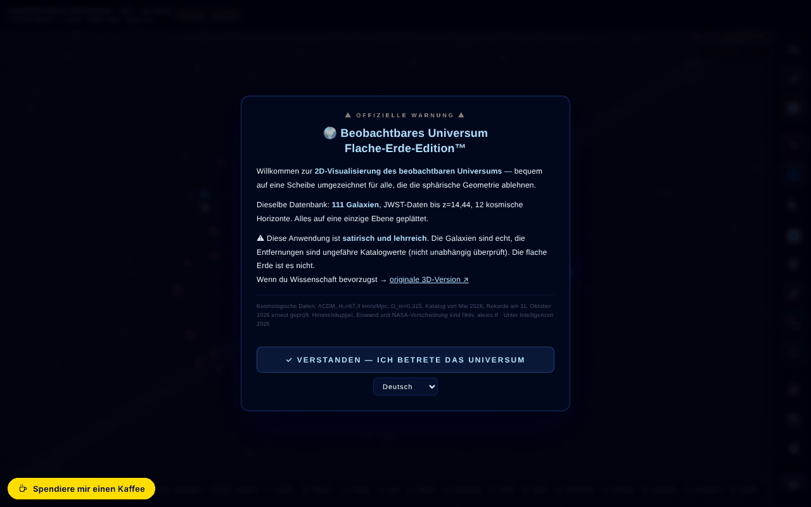

# Observable Universe 2D · v5.12.4 · Flat Earth Edition™

[English](README.md) · [Română](README.ro.md) · [Français](README.fr.md) · [Italiano](README.it.md) · [Español](README.es.md) · [Português](README.pt.md) · **Deutsch** · [Magyar](README.hu.md)

**Version:** 5.12.6 · **Zuletzt aktualisiert:** 2026-10-22

Oberflächensprachen: **Română, English, Français, Italiano, Español, Português (PT), Deutsch, Magyar**

Interaktive 2D-Karte des beobachtbaren Universums in logarithmischem Maßstab, mit 112 Katalogeinträgen (111 Galaxien + der kosmische Hintergrund CMB) — in einer satirischen „Flache-Erde“-Edition.

**Online-App:** https://chiuta.github.io/Universul-Observabil-2D/

## Was es ist

Eine Ein-Datei-Anwendung (`index.html`, Canvas + JavaScript), die das beobachtbare Universum als flache Scheibe in logarithmischem Maßstab darstellt, mit 111 Galaxien (plus CMB-Hintergrund = 112 Einträge), kosmischen Horizonten und JWST-Daten (der Katalog der Anwendung ist auf Mai 2026 datiert; angezeigter Rekord: MoM-z14, z=14,44, am 11. Oktober 2026 erneut geprüft). Die Edition „Flache Erde™“ ist humoristisch/satirisch, und die Anwendung enthält außerdem einen Abschnitt, der die Theorie der flachen Erde widerlegt, sowie einen über die Grenzen der Simulation.

## Funktionen

- Navigation: Zoom (Scrollen, +/-), Verschieben, Ansicht zurücksetzen, Navigation rückgängig machen (Z), Seitenmenü.
- Visuelle Ebenen (Beschriftungen, Raster, Ringe, Filamente, Heatmap, Gravitationsgruppen, Spektrummodus usw.), mit Korrekturen für Farbfehlsichtigkeit (Deuteranopie, Protanopie, Tritanopie, Achromatopsie).
- Lineal (M): Die Galaxien A und B werden per Klick auf die Karte oder nach Namen gewählt (Felder mit Liste, per Tastatur bedienbar), mit einer Schaltfläche „Ergebnis kopieren“.
- Galaxiensuche, zufällige Galaxie, Favoriten (mit CSV-Export), CSV-Export der 112 Einträge (111 Galaxien + CMB).
- Geführte Tour, Kosmisches Quiz mit lokaler Bestenliste, „Zehnerpotenzen“, Maßstabsvergleich, geteilter Bildschirm, Andromeda-Simulation, „Wusstest du…“, Messwerkzeug, Statistiken.
- Adaptiver Soundtrack (Web Audio) mit Ein-/Ausschalter und Lautstärke.
- PNG-Export und Drucken; Permalink mit dem vollständigen Zustand (`#s=...`).
- Integrierter Leitfaden: Intro, Navigation, Visuelle Ebenen, Zeitleiste der Entfernungsrekorde, Flache Erde, Glossar, Häufige Fragen, Grenzen der Simulation, Versionsverlauf, Credits und Quellen.
- Oberfläche in 8 Sprachen (RO, EN, FR, IT, ES, PT, DE, HU).
- **Sprachen:** die Anleitung (10 Seiten), die 112 Galaxienbeschreibungen, die 25 „Wusstest du schon?“, die Tourtexte, Zehnerpotenzen, die Zeitleistenmarken, der Lehrermodus, die Meldung zum Ereignis vom 8. Mai, die Zeilen des A3-Posters und die Beschreibungen in Quiz und Vergleicher liegen in den 8 Sprachen vor. Unverändert bleiben: der Versionsverlauf bis v5.8 (auf Englisch; ein Hinweis in der Anleitung sagt das), der App-Name in der Kopfzeile, Eigennamen und Quellen. Die Übersetzungen sind automatisch; eine muttersprachliche Prüfung wird empfohlen.
- Beschriftungen, die sich überlagern würden, werden automatisch weggelassen (sie erscheinen bei stärkerem Zoom).

## Bedienungsanleitung

1. Beim ersten Besuch erscheint ein kurzes Tutorial; du kannst es überspringen („Skip tutorial“).
2. Navigation: Scrollen zum Zoomen, Ziehen zum Verschieben, **R** setzt zurück, **Z** kehrt zur vorherigen Position zurück.
3. Öffne das Menü ☰ oder nutze die obere Leiste für Search, Tour, Quiz, Powers×10, Scale, Andromeda, Split Screen, Did you know, Measure, Favorites, Stats, Random, Export PNG.
4. Tasten: **/** Suche, **R** Zurücksetzen, **L** Beschriftungen, **S** Ton, **C** Maßstabsvergleich, **H** Heatmap, **P** PNG-Export, **T** Tour, **M** Messen, **Q** Quiz, **D** zufällige Galaxie, **F** Favoriten, **G** Gravitationsgruppen, **N** Sprache wechseln, **O** Powers of Ten, **X** geteilter Bildschirm, **A** Andromeda-Simulation, **Z** Navigation rückgängig, **`** Seitenmenü, **?** Liste der Tastenkürzel, **Esc** schließt die Fenster.
5. Sprache: die Taste **N** (wechselt durch die Sprachen) oder das Sprachmenü in der Leiste.
6. Farbfehlsichtigkeit: Wähle den Modus im Ebenen-Fenster (Normal, Deuteranopia, Protanopia, Tritanopia, Achromatopsia).
7. Speichern: Stern ⭐ für Favoriten, „⬇ Export favorites CSV“, „⬇ Export CSV (112 entries)“ oder „📸 Export PNG“.

## Datenschutz und Netzwerk

- **Lokaler Speicher:** `localStorage` — `uv_lang` (Sprache), `uv2d_favs` (Favoriten), `uv2d_prefs_v1` (Einstellungen: Farbfehlsichtigkeit, Ebenen, Ton, Lautstärke), dazu die Quiz-Ergebnisse; `sessionStorage` — `tut_done`, `uv_eventGreetingShown`. Die Anwendung erklärt, dass nichts an einen Server gesendet wird (sie hat kein Backend).
- **Service Worker:** In der Datei existiert Code für einen Service Worker aus einem Blob, doch Browser lehnen die Registrierung eines Service Workers aus `blob:` ab; praktisch ist er inaktiv. Die Anwendung funktioniert offline, weil sie eine einzelne lokale Datei ist, nicht dank eines Caches.
- **Netzwerk:** Ich habe keine `fetch`-Datenaufrufe an Drittdienste gefunden. Die Links zu alexio.tf, ares.org.ro, Buy Me a Coffee, Wikipedia, ADS und ESA Sky öffnen sich nur per Klick. Die Meta-Tags (Open Graph, Vorschaubild) verweisen auf alexio.tf, ohne Wirkung zur Laufzeit.

## Hinweis: satirische Edition

Die Edition „Flache Erde™“ ist satirisch. Die Elemente Himmelsgewölbe, Eiswand, „NASA-Verschwörung“ und Weltraumschildkröte sind fiktiv; die Galaxien und Entfernungen sind die aus dem Katalog. Zusätzlich zur Warnung beim Öffnen zeigt die Seite jetzt dauerhaft in der oberen Leiste (auch auf Mobilgeräten) die Kennzeichnung „SATIRĂ · SATIRE“.

## Daten und Quellen
Die „Rekord“-Aussagen (MoM-z14, z = 14,44) gelten **zum Katalogdatum (Mai 2026), erneut geprüft am 11. Oktober 2026**, und können übertroffen werden. Quelle: Naidu et al., arXiv:2505.11263 (Preprint Mai 2025; veröffentlicht im Open Journal of Astrophysics, Januar 2026). Der Eintrag EGS-z11-R0 (März 2026, arXiv:2603.15841; auch von phys.org berichtet, März 2026) wurde nicht im Detail unabhängig überprüft. Die Entfernungen sind Näherungswerte aus dem Katalog der Anwendung (ΛCDM, Planck 2018), zu Bildungszwecken. Die Zitierreferenz enthält keinen DOI mehr (die Anwendung hat noch keinen). Bibliografie pro Galaxie: in Arbeit.

## Lokale Ausführung / offline

Lade `index.html` herunter und öffne sie in einem Browser; sie funktioniert ohne Internet. Die Anwendung bleibt ohne Internet funktionsfähig (der Blob-Service-Worker ist inaktiv).

## Verlauf / Changelog

### 5.12.6 — 2026-10-22
- fff-kit 1.1.2: PBKDF2 mit 600.000 Iterationen, Schutz vor Clickjacking.

### 5.12.5 — 2026-10-22
- Wirklich offline: Der defekte eingebettete Service Worker (blob:-URL, die die Seite nie zwischenspeichern kann) wurde durch einen echten sw.js (Cache zuerst mit Hintergrund-Revalidierung), ein Web-Manifest und Symbole ersetzt; die App öffnet sich nun nach dem ersten Besuch ohne Netz und kann installiert werden. Auch der QR-Generator wird vorab zwischengespeichert.
- Barrierefreiheit: Die Seite hat jetzt genau eine H1 (die Titelleiste); das Vergleichssuchfeld, der Zeitachsen-Geschwindigkeitsregler und die beiden Regler der geteilten Ansicht haben Namen, die Screenreader ansagen (8 Sprachen); Schieberegler haben 24-px-Touch-Flächen.
- Exportierte PNG-Aufnahmen tragen nun den Vermerk „PARODIE · Flache-Erde-Edition™ — die Erde ist nicht flach“ (in der Oberflächensprache), damit eine Aufnahme nicht aus dem Zusammenhang gerissen zitiert werden kann.
- Mobil: Der gesamte Oberflächentext ist mindestens 12 px groß.

- 5.12.4 — 2026-10-22: die übrigen rumänischen Galaxiennamen (Milchstraße, Dreiecksnebel, Zigarre, Feuerrad, Strudel, Nadel, Schwarzes Auge, Sonnenblume, Antennen, Feuerwerk, Geschoss, Phönix, Linse, Zwerggalaxie im Großen Hund, CMB-Horizont u. a.) und die Beschriftungen der Gravitationsgruppen auf der Karte sind in allen 8 Sprachen übersetzt; die internen Schlüssel bleiben unverändert.
- 5.12.3 — 2026-10-22: die Bezeichnungen der beiden Magellanschen Wolken (LMC/SMC) sind in allen 8 Sprachen übersetzt (Abkürzungen bleiben); der Titel der oberen Leiste (BEOBACHTBARES UNIVERSUM · 2D) und der PNG-Exporttitel folgen der Oberflächensprache; das Satire-Etikett wiederholt das Wort in fr/it/es/pt/de/hu nicht mehr.
- 5.12.2 — 2026-10-22: Die Oberfläche ist jetzt auch auf Rumänisch und Englisch vollständig (Seitenleiste, Tastenkürzel, Ticker, Tooltips und aria-label mischen die beiden Sprachen nicht mehr); Seitentitel und Meta-Beschreibungen folgen der Oberflächensprache.

### 5.12.1 — 2026-10-19
- Anleitung, Galaxienbeschreibungen, „Wusstest du schon?“, Tour, Zehnerpotenzen, Zeitleistenmarken, Lehrermodus und A3-Poster sind nach fr, it, es, pt, de, hu übersetzt; die falsche Aussage, sie „bleiben auf ro/en“, wurde korrigiert.

### 5.11.0 — 2026-10-19
- Schaltfläche „📏 1D-ACHSE ↗“ im Galaxienfenster (dieselbe Galaxie, aktuelle Sprache); der Permalink `#g=` akzeptiert den Guard `gn`.

### 5.10.0 — 2026-10-14
- Datensicherung und Datenkennzeichnung (fff-kit).

### 12. Oktober 2026 — Version 5.9.4
- 5.9.4 — 2026-10-12: Version und Datum der letzten Aktualisierung werden in der App angezeigt

### 11. Oktober 2026 (dritter Durchgang) — Version 5.9.3
- Lineal: teilweiser Namensabgleich (bei Enter/Verlassen des Feldes) mit klarer Meldung, wenn es keinen oder mehrere Treffer gibt.
- Das Unterstützungs-Widget wird ausgeblendet, solange die Anfangswarnung angezeigt wird (bei 360 px verdeckte es die RO/EN-Schaltfläche). CSP: Hash neu berechnet.

### 11. Oktober 2026 (zweiter Durchgang) — Version 5.9.2
- Lineal: Auswahl der Galaxien A/B nach Namen (ohne Klick auf die Karte) und „Ergebnis kopieren“; die Texte nennen jetzt „111 Galaxien“ (+ CMB = 112 Einträge) statt „112 Galaxien“; RO/EN-Verlauf im Leitfaden; CSP: Hash neu berechnet.

### 11. Oktober 2026
- Version 5.9.1 (Titel, Meta, JSON-LD, `VERSION`, SW-Cache, integrierter Leitfaden — RO/EN-Verlauf).
- Ein Kommentar korrigiert, der buchstäblich das Schließen des Script-Tags enthielt: ~3 KB Code (Zustand der Schaltflächen der mobilen Leiste, Fokusfalle für die Schublade) erschienen als Text auf der Seite und wurden nicht ausgeführt; derselbe Fehler verursachte horizontales Scrollen bei 360 px.
- Lineal und Touch auf Mobilgeräten finden die Galaxie am gedrückten Punkt; Beschriftungen ohne Überlagerung; die Buy-Me-a-Coffee-Pille verdeckt die mobile Leiste nicht mehr.
- Barrierefreiheit: `<main>`, Dialog für die Warnung, Navigation für die Schublade, Ticker als Region; axe-core 0 Verstöße bei 1280 und 360 px.
- Sicherheit: Die 87 Inline-Attribute `on*` wurden durch delegierte Handler ersetzt (`data-onclick` usw., ohne `eval` interpretiert); die CSP verwendet einen SHA-256-Hash für das Skript, ohne `'unsafe-inline'` in `script-src`.
- Die Fußzeile zeigte „111 Galaxien“ gegenüber „112“ sonst: jetzt „112 Einträge (111 Galaxien + CMB)“.

**Am 11.10.2026 geprüfte Quellen:** Wikipedia — List of the most distant astronomical objects (MoM-z14, z=14,44, der aktuelle spektroskopische Rekord; Kandidaten mit höherem photometrischem z bleiben unbestätigt); phys.org, 2026-03 (EGS-z11-R0, z≈11,45).

## Lizenz

MIT — siehe Datei LICENSE

## Audit

Audit: 2026-10-10 — der einzige `fetch` in der Datei befindet sich im Blob-Service-Worker (GET-Cache, same-origin; CSP `connect-src 'self'`); es gibt keine Datenaufrufe an Dritte. Die Satire wird beim ersten Öffnen ausdrücklich gekennzeichnet („satirical and educational… The flat Earth is not“). Die Daten im Katalog (einschließlich des JWST-Rekords MoM-z14, z=14,44) stammen aus den Inhalten des Autors und wurden in diesem Audit nicht unabhängig überprüft. Korrekturen zur Barrierefreiheit: Viewport (Zoom erlaubt), Beschriftungen für die Filterregler.

## Rechte und Quellenangabe
Die Anwendung und der Code gehören dem Autor (MIT-Lizenz, siehe `LICENSE`). Die astronomischen Daten stammen aus öffentlichen Veröffentlichungen und Katalogen; die Rechte an Materialien Dritter liegen bei deren Inhabern, und die MIT-Lizenz deckt sie nicht ab. Wenn du Rechteinhaber oder eine erwähnte Person bist und eine Berichtigung oder Entfernung wünschst, schreibe an alexio@trom.tf; wir antworten innerhalb von 7 Tagen.

## Autor

Alexio — Alexandru-Ionuț Chiuță, Kontakt: alexio@trom.tf. Die Anwendung nennt den Autor zusammen mit ARES (ares.org.ro) und dem Centrul StrING.

## Zusammenfassung
Eine interaktive 2D-Karte des beobachtbaren Universums in einer einzigen Datei, in logarithmischem Maßstab, mit 111 Galaxien (plus CMB-Hintergrund = 112 Einträge), JWST-Daten (Katalog datiert auf Mai 2026), Tour, Quiz mit lokaler Bestenliste, Zehnerpotenzen, geteiltem Bildschirm, Andromeda-Simulation, Modi für Farbfehlsichtige, CSV-/PNG-Export und einer satirischen „Flat Earth Edition“ mit integriertem Leitfaden. 8 Sprachen. Einstellungen in localStorage gespeichert; keine Datenanfragen an Dritte. MIT-Lizenz.

Runde 3: 2026-10-11 — Formulierungen „zum Katalogdatum“, fiktiver DOI aus dem Leitfaden entfernt, zweisprachige Beschriftungen für die Filterregler.
