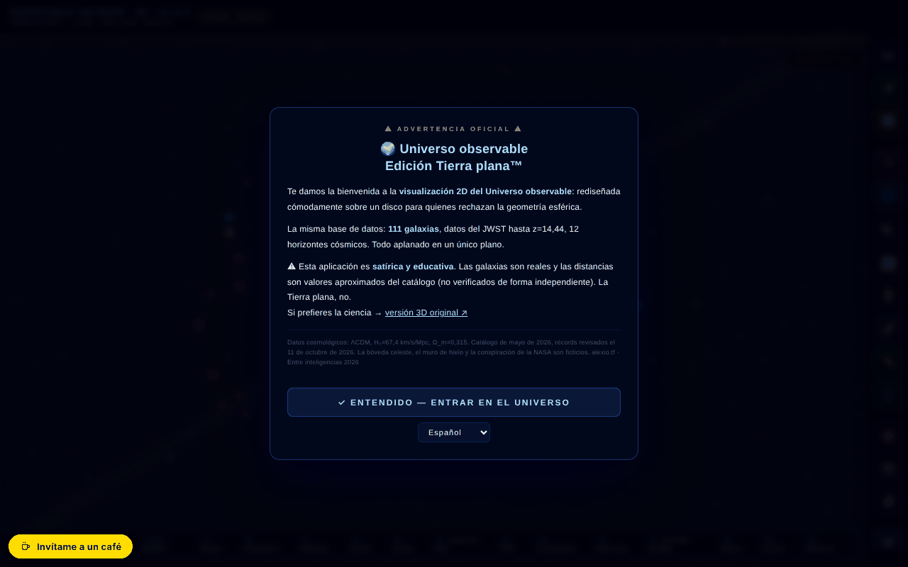

# Observable Universe 2D · v5.12.4 · Flat Earth Edition™

[English](README.md) · [Română](README.ro.md) · [Français](README.fr.md) · [Italiano](README.it.md) · **Español** · [Português](README.pt.md) · [Deutsch](README.de.md) · [Magyar](README.hu.md)

**Versión:** 5.12.10 · **Última actualización:** 2026-10-23

Idiomas de la interfaz: **Română, English, Français, Italiano, Español, Português (PT), Deutsch, Magyar**

Mapa 2D interactivo del universo observable, en escala logarítmica, con 112 entradas de catálogo (111 galaxias + el fondo cósmico CMB) — en una edición satírica «Tierra Plana».

**Aplicación en línea:** https://chiuta.github.io/Universul-Observabil-2D/

## Qué es

Una aplicación de un solo archivo (`index.html`, canvas + JavaScript) que muestra el universo observable como un disco plano, en escala logarítmica, con 111 galaxias (más el fondo CMB = 112 entradas), horizontes cósmicos y datos del JWST (el catálogo de la aplicación está fechado en mayo de 2026; récord mostrado: MoM-z14, z=14,44, reverificado el 11 de octubre de 2026). La edición «Tierra Plana™» es humorística/satírica, y la aplicación incluye además una sección que desmonta la teoría de la Tierra plana y otra sobre los límites de la simulación.

## Funciones

- Navegación: zoom (rueda, +/-), desplazamiento, restablecimiento de la vista, deshacer navegación (Z), menú lateral.
- Capas visuales (etiquetas, cuadrícula, anillos, filamentos, mapa de calor, grupos gravitacionales, modo espectro, etc.), con correcciones para el daltonismo (deuteranopía, protanopía, tritanopía, acromatopsia).
- Regla (M): las galaxias A y B se eligen con un clic en el mapa o por nombre (campos con lista, utilizables con el teclado), con un botón «Copiar el resultado».
- Búsqueda de galaxias, galaxia aleatoria, favoritos (con exportación CSV), exportación CSV de las 112 entradas (111 galaxias + CMB).
- Recorrido guiado, Cuestionario cósmico con clasificación local, «Potencias de 10», comparador de escala, pantalla dividida, simulación de Andrómeda, «¿Sabías que…?», herramienta de medición, estadísticas.
- Banda sonora adaptativa (Web Audio) con activación/desactivación y volumen.
- Exportación PNG e impresión; permalink con el estado completo (`#s=...`).
- Guía integrada: Intro, Navegación, Capas visuales, Cronología de los récords de distancia, Tierra plana, Glosario, Preguntas frecuentes, Límites de la simulación, Historial de versiones, Créditos y fuentes.
- Interfaz en 8 idiomas (RO, EN, FR, IT, ES, PT, DE, HU).
- **Idiomas:** la guía (10 fichas), las 112 descripciones de galaxias, los 25 «¿Sabías que?», las narraciones de la visita, las Potencias de diez, los hitos de la cronología, el modo profesor, el mensaje del evento del 8 de mayo, las líneas del póster A3 y las descripciones del cuestionario y del comparador están disponibles en los 8 idiomas. Permanecen sin cambios: el historial de versiones v5.8 y anteriores (en inglés; una nota de la guía lo indica), el nombre de la aplicación en la cabecera, los nombres propios y las fuentes. Las traducciones son automáticas; se recomienda revisión nativa.
- Las etiquetas que se solaparían se omiten automáticamente (aparecen con un zoom mayor).

## Guía de uso

1. En la primera visita aparece un breve tutorial; puedes omitirlo («Skip tutorial»).
2. Navega: scroll para el zoom, arrastra para desplazarte, **R** restablece, **Z** vuelve a la posición anterior.
3. Abre el menú ☰ o usa la barra superior para Search, Tour, Quiz, Powers×10, Scale, Andromeda, Split Screen, Did you know, Measure, Favorites, Stats, Random, Export PNG.
4. Teclas: **/** búsqueda, **R** restablecer, **L** etiquetas, **S** sonido, **C** comparador de escala, **H** mapa de calor, **P** exportar PNG, **T** recorrido, **M** medición, **Q** cuestionario, **D** galaxia aleatoria, **F** favoritos, **G** grupos gravitacionales, **N** cambiar de idioma, **O** Powers of Ten, **X** pantalla dividida, **A** simulación de Andrómeda, **Z** deshacer la navegación, **`** menú lateral, **?** lista de atajos, **Esc** cierra los paneles.
5. Idioma: la tecla **N** (recorre los idiomas) o el menú de idioma de la barra.
6. Daltonismo: elige el modo en el panel de capas (Normal, Deuteranopia, Protanopia, Tritanopia, Achromatopsia).
7. Guardado: estrella ⭐ para favoritos, «⬇ Export favorites CSV», «⬇ Export CSV (112 entries)» o «📸 Export PNG».

## Privacidad y red

- **Almacenamiento local:** `localStorage` — `universul-observabil-2d.lang` (idioma), `universul-observabil-2d.favs` (favoritos), `universul-observabil-2d.prefs` (preferencias: daltonismo, capas, sonido, volumen), además de las puntuaciones del cuestionario; `sessionStorage` — `tut_done`, `uv_eventGreetingShown`. La aplicación afirma que no se envía nada a ningún servidor (no tiene backend).
- **Service worker:** en el archivo existe el código de un service worker desde un blob, pero los navegadores rechazan el registro de un service worker desde `blob:`; en la práctica está inactivo. La aplicación funciona sin conexión porque es un único archivo local, no gracias a una caché.
- **Red:** no encontré llamadas `fetch` de datos a servicios de terceros. Los enlaces a alexio.tf, ares.org.ro, Buy Me a Coffee, Wikipedia, ADS y ESA Sky solo se abren al hacer clic. Las metaetiquetas (Open Graph, imagen de vista previa) apuntan a alexio.tf, sin efecto en la ejecución.

## Nota: edición satírica

La edición «Tierra Plana™» es satírica. Los elementos Bóveda Celeste, Muro de Hielo, «Conspiración de la NASA» y Tortuga Espacial son ficticios; las galaxias y las distancias son las del catálogo. Además de la advertencia de apertura, la página muestra ahora de forma permanente, en la barra superior (también en móvil), la etiqueta «SATIRĂ · SATIRE».

## Datos y fuentes
Las afirmaciones de «récord» (MoM-z14, z = 14,44) son válidas **a la fecha del catálogo (mayo de 2026), reverificadas el 11 de octubre de 2026**, y pueden ser superadas. Fuente: Naidu et al., arXiv:2505.11263 (preprint de mayo de 2025; publicado en el Open Journal of Astrophysics, enero de 2026). La entrada EGS-z11-R0 (marzo de 2026, arXiv:2603.15841; recogida también por phys.org, marzo de 2026) no se verificó de forma independiente en detalle. Las distancias son valores aproximados del catálogo de la aplicación (ΛCDM, Planck 2018), con fines educativos. La referencia de cita ya no contiene un DOI (la aplicación todavía no tiene uno). Bibliografía por galaxia: en curso de elaboración.

## Ejecución local / offline

Descarga `index.html` y ábrelo en un navegador; funciona sin internet. La aplicación sigue siendo funcional sin internet (el service worker desde blob está inactivo).

## Historial / Changelog

### 5.12.10 — 2026-10-23
- Robustez: las preferencias, favoritos y clasificación del quiz corruptos en `localStorage` se ignoran en vez de bloquear la aplicación; los enlaces #g=… con valores extremos o `%` inválido ya no rompen el renderizado (zoom/pan acotados); la versión mostrada en el título y la Guía vuelve a ser la real.

### 5.12.9 — 2026-10-23
- fff-kit 1.2.0: las claves del navegador llevan ahora el prefijo de la aplicación (`universul-observabil-2d.lang`, `.favs`, `.prefs`); las antiguas (`uv_lang`, `uv2d_favs`, `uv2d_prefs_v1`) se migran automáticamente al iniciar, también tras importar una copia .fff.json antigua. La alternativa «copiar el enlace» ya no usa el cuadro nativo del navegador, sino un diálogo accesible en el idioma de la interfaz.

### 5.12.7 — 2026-10-22
- fff-kit 1.1.4: objetivos táctiles y texto mínimo; objetivos táctiles/texto corregidos

### 5.12.6 — 2026-10-22
- fff-kit 1.1.2: PBKDF2 con 600.000 iteraciones, protección anti-clickjacking.

### 5.12.5 — 2026-10-22
- Sin conexión de verdad: el service worker integrado defectuoso (URL blob:, que nunca puede almacenar la página en caché) se sustituyó por un sw.js real (caché primero con revalidación en segundo plano), un manifiesto web e iconos; la aplicación se abre ahora sin red tras la primera visita y se puede instalar. El generador de QR también queda precargado en caché.
- Accesibilidad: la página tiene ahora exactamente un H1 (la barra de título); el campo de búsqueda de comparación, el control de velocidad de la cronología y los dos controles de la vista dividida tienen un nombre que anuncian los lectores de pantalla (8 idiomas); los controles deslizantes tienen áreas táctiles de 24 px.
- Las capturas PNG exportadas llevan ahora la marca «PARODIA · Edición Tierra plana™ — la Tierra no es plana» (en el idioma de la interfaz), para que una captura no pueda citarse fuera de contexto.
- Móvil: todo el texto de la interfaz mide al menos 12 px.

- 5.12.4 — 2026-10-22: los nombres rumanos de galaxias que quedaban (Vía Láctea, Triángulo, Cigarro, Molinete, Remolino, Aguja, Ojo negro, Girasol, Antenas, Fuegos artificiales, Bala, Fénix, Lente, Enana del Can Mayor, Horizonte CMB, etc.) y las etiquetas de los grupos gravitacionales del mapa se traducen a los 8 idiomas; las claves internas no cambian.
- 5.12.3 — 2026-10-22: las etiquetas de las dos Nubes de Magallanes (LMC/SMC) se traducen a los 8 idiomas (siglas conservadas); el título de la barra superior (UNIVERSO OBSERVABLE · 2D) y el de la exportación PNG siguen el idioma de la interfaz; la etiqueta de sátira ya no repite la palabra en fr/it/es/pt/de/hu.
- 5.12.2 — 2026-10-22: la interfaz es ahora completa también en rumano e inglés (barra lateral, atajos, cinta de noticias, descripciones emergentes y aria-label ya no mezclan los dos idiomas); el título de la página y las metadescripciones siguen el idioma de la interfaz.

### 5.12.1 — 2026-10-19
- La guía, las descripciones de galaxias, los «¿Sabías que?», la visita, las Potencias de diez, los hitos de la cronología, el modo profesor y el póster A3 están traducidos a fr, it, es, pt, de, hu; se corrigió la afirmación falsa de que «permanecen en ro/en».

### 5.11.0 — 2026-10-19
- Botón «📏 EJE 1D ↗» en el panel de la galaxia (la misma galaxia, idioma actual); el permalink `#g=` acepta la guarda `gn`.

### 5.10.0 — 2026-10-14
- Copia de seguridad y etiquetado de datos (fff-kit).

### 12 de octubre de 2026 — versión 5.9.4
- 5.9.4 — 2026-10-12: la versión y la fecha de la última actualización se muestran en la aplicación

### 11 de octubre de 2026 (tercera pasada) — versión 5.9.3
- Regla: coincidencia parcial del nombre (al pulsar Enter/salir del campo) con un mensaje claro cuando no hay coincidencia o hay varias.
- El widget de apoyo se oculta mientras se muestra la advertencia inicial (a 360 px cubría el botón RO/EN). CSP: hash recalculado.

### 11 de octubre de 2026 (segunda pasada) — versión 5.9.2
- Regla: elección de las galaxias A/B por nombre (sin clic en el mapa) y «Copiar el resultado»; los textos indican ahora «111 galaxias» (+ CMB = 112 entradas) en lugar de «112 galaxias»; historial RO/EN en la guía; CSP: hash recalculado.

### 11 de octubre de 2026
- Versión 5.9.1 (título, meta, JSON-LD, `VERSION`, caché del SW, guía integrada — historial RO/EN).
- Corregido un comentario que contenía literalmente el cierre de la etiqueta script: ~3 KB de código (estado de los botones de la barra móvil, trampa de foco para el cajón) aparecían como texto en la página y no se ejecutaban; el mismo defecto producía desplazamiento horizontal a 360 px.
- La regla y el toque en móvil encuentran la galaxia en el punto pulsado; etiquetas sin solapamiento; la píldora de Buy Me a Coffee ya no cubre la barra móvil.
- Accesibilidad: `<main>`, diálogo para la advertencia, navegación para el cajón, ticker como región; axe-core 0 infracciones a 1280 y 360 px.
- Seguridad: los 87 atributos `on*` en línea se sustituyeron por manejadores delegados (`data-onclick`, etc., interpretados sin `eval`); la CSP usa un hash SHA-256 para el script, sin `'unsafe-inline'` en `script-src`.
- El pie de página mostraba «111 galaxias» frente a «112» en el resto: ahora «112 entradas (111 galaxias + CMB)».

**Fuentes verificadas el 11.10.2026:** Wikipedia — List of the most distant astronomical objects (MoM-z14, z=14,44, el récord espectroscópico actual; los candidatos con z fotométrico mayor siguen sin confirmar); phys.org, 2026-03 (EGS-z11-R0, z≈11,45).

## Licencia

MIT — véase el archivo LICENSE

## Auditoría

Auditoría: 2026-10-10 — el único `fetch` del archivo está en el service worker desde blob (caché GET, mismo origen; CSP `connect-src 'self'`); no hay llamadas de datos a terceros. La sátira se señala explícitamente en la primera apertura («satirical and educational… The flat Earth is not»). Los datos del catálogo (incluido el récord del JWST MoM-z14, z=14,44) proceden del contenido del autor y no se verificaron de forma independiente en esta auditoría. Correcciones de accesibilidad: viewport (zoom permitido), etiquetas para los deslizadores de filtrado.

## Derechos y atribución
La aplicación y el código pertenecen al autor (licencia MIT, véase `LICENSE`). Los datos astronómicos proceden de publicaciones y catálogos públicos; los derechos sobre materiales de terceros pertenecen a sus titulares, y la licencia MIT no los cubre. Si eres titular de derechos o una persona mencionada y deseas una corrección o retirada, escribe a alexio@trom.tf; respondemos en 7 días.

## Autor

Alexio — Alexandru-Ionuț Chiuță, contacto: alexio@trom.tf. La aplicación acredita al autor junto con ARES (ares.org.ro) y el Centrul StrING.

## Resumen

Un mapa 2D interactivo del universo observable en un solo archivo, en escala logarítmica, con 111 galaxias (más el fondo CMB = 112 entradas), datos del JWST (catálogo fechado en mayo de 2026), recorrido, cuestionario con clasificación local, Potencias de 10, pantalla dividida, simulación de Andrómeda, modos para daltónicos, exportación CSV/PNG y una «Flat Earth Edition» satírica con guía integrada. 8 idiomas. Preferencias guardadas en localStorage; sin solicitudes de datos a terceros. Licencia MIT.

Ronda 3: 2026-10-11 — formulaciones «a la fecha del catálogo», DOI ficticio eliminado de la guía, etiquetas bilingües para los deslizadores de filtrado.
