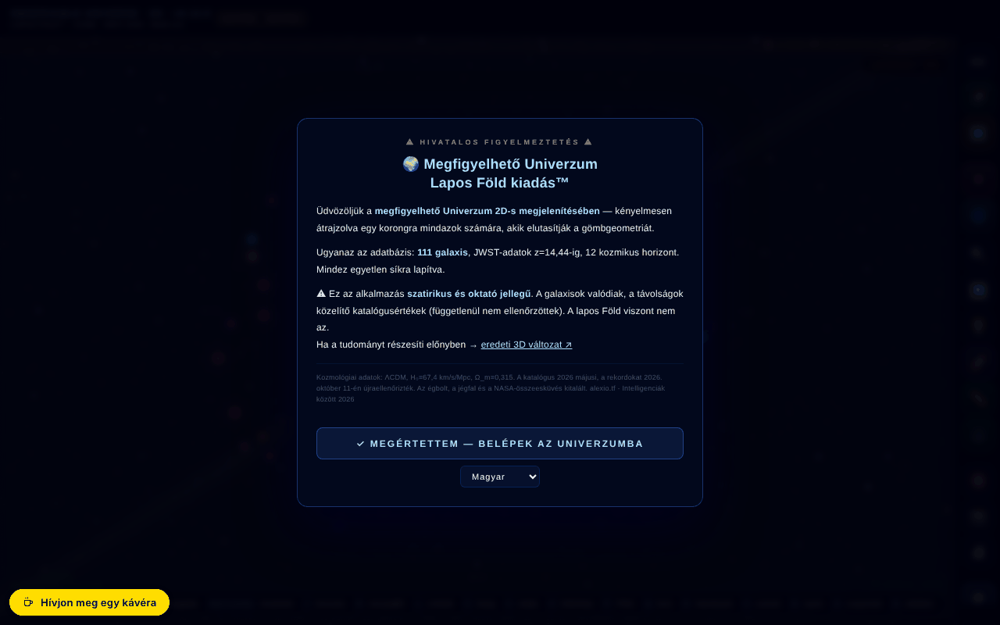

# Observable Universe 2D · v5.11.0 · Flat Earth Edition™

[English](README.md) · [Română](README.ro.md) · [Français](README.fr.md) · [Italiano](README.it.md) · [Español](README.es.md) · [Português](README.pt.md) · [Deutsch](README.de.md) · **Magyar**

**Verzió:** 5.12.1 · **Utolsó frissítés:** 2026-10-19

A felület nyelvei: **Română, English, Français, Italiano, Español, Português (PT), Deutsch, Magyar**

A megfigyelhető univerzum interaktív 2D-s térképe logaritmikus skálán, 112 katalógusbejegyzéssel (111 galaxis + a CMB kozmikus háttér) — szatirikus „Lapos Föld” kiadásban.

**Online alkalmazás:** https://chiuta.github.io/Universul-Observabil-2D/

## Mi ez

Egyfájlos alkalmazás (`index.html`, canvas + JavaScript), amely a megfigyelhető univerzumot lapos korongként, logaritmikus skálán jeleníti meg, 111 galaxissal (plusz a CMB-háttér = 112 bejegyzés), kozmikus horizontokkal és JWST-adatokkal (az alkalmazás katalógusa 2026 májusi keltezésű; a megjelenített rekord: MoM-z14, z=14,44, 2026. október 11-én újraellenőrizve). A „Lapos Föld™” kiadás humoros/szatirikus, és az alkalmazás tartalmaz egy szakaszt, amely cáfolja a lapos Föld elméletét, valamint egyet a szimuláció korlátairól.

## Funkciók

- Navigáció: nagyítás (görgetés, +/-), mozgatás, nézet visszaállítása, navigáció visszavonása (Z), oldalmenü.
- Vizuális rétegek (feliratok, rács, gyűrűk, filamentumok, hőtérkép, gravitációs csoportok, spektrum mód stb.), színtévesztés-korrekciókkal (deuteranópia, protanópia, tritanópia, akromatopszia).
- Vonalzó (M): az A és B galaxist a térképre kattintva vagy név szerint lehet kiválasztani (listás mezők, billentyűzettel is használhatók), „Eredmény másolása” gombbal.
- Galaxiskeresés, véletlen galaxis, kedvencek (CSV-exporttal), a 112 bejegyzés CSV-exportja (111 galaxis + CMB).
- Vezetett túra, Kozmikus kvíz helyi ranglistával, „A 10 hatványai”, skálaösszehasonlító, osztott képernyő, Androméda-szimuláció, „Tudtad, hogy…”, mérőeszköz, statisztikák.
- Adaptív hangsáv (Web Audio) be-/kikapcsolással és hangerővel.
- PNG-export és nyomtatás; permalink a teljes állapottal (`#s=...`).
- Beépített útmutató: Intro, Navigáció, Vizuális rétegek, A távolsági rekordok idővonala, Lapos Föld, Szószedet, Gyakori kérdések, A szimuláció korlátai, Verziótörténet, Köszönetnyilvánítás és források.
- 8 nyelvű felület (RO, EN, FR, IT, ES, PT, DE, HU).
- Az egymást fedő feliratok automatikusan kimaradnak (nagyobb nagyításnál megjelennek).

## Használati útmutató

1. Az első látogatáskor rövid bemutató jelenik meg; kihagyhatod („Skip tutorial”).
2. Navigálás: görgetés a nagyításhoz, húzás a mozgatáshoz, az **R** visszaállít, a **Z** visszatér az előző pozícióra.
3. Nyisd meg a ☰ menüt, vagy használd a felső sávot a Search, Tour, Quiz, Powers×10, Scale, Andromeda, Split Screen, Did you know, Measure, Favorites, Stats, Random, Export PNG funkciókhoz.
4. Billentyűk: **/** keresés, **R** visszaállítás, **L** feliratok, **S** hang, **C** skálaösszehasonlító, **H** hőtérkép, **P** PNG-export, **T** túra, **M** mérés, **Q** kvíz, **D** véletlen galaxis, **F** kedvencek, **G** gravitációs csoportok, **N** nyelvváltás, **O** Powers of Ten, **X** osztott képernyő, **A** Androméda-szimuláció, **Z** navigáció visszavonása, **`** oldalmenü, **?** a gyorsbillentyűk listája, **Esc** bezárja a paneleket.
5. Nyelv: az **N** billentyű (végigléptet a nyelveken) vagy a sávban lévő nyelvi menü.
6. Színtévesztés: válaszd ki a módot a rétegek panelen (Normal, Deuteranopia, Protanopia, Tritanopia, Achromatopsia).
7. Mentés: csillag ⭐ a kedvencekhez, „⬇ Export favorites CSV”, „⬇ Export CSV (112 entries)” vagy „📸 Export PNG”.

## Adatvédelem és hálózat

- **Helyi tárolás:** `localStorage` — `uv_lang` (nyelv), `uv2d_favs` (kedvencek), `uv2d_prefs_v1` (beállítások: színtévesztés, rétegek, hang, hangerő), valamint a kvíz pontszámai; `sessionStorage` — `tut_done`, `uv_eventGreetingShown`. Az alkalmazás kijelenti, hogy semmi sem kerül elküldésre szervernek (nincs háttérrendszere).
- **Service worker:** a fájlban megtalálható egy blobból származó service worker kódja, de a böngészők elutasítják a service worker regisztrálását `blob:` forrásból; a gyakorlatban inaktív. Az alkalmazás offline működik, mert egyetlen helyi fájl, nem a gyorsítótárnak köszönhetően.
- **Hálózat:** nem találtam adatlekérő `fetch` hívást harmadik fél szolgáltatásaihoz. Az alexio.tf, ares.org.ro, Buy Me a Coffee, Wikipedia, ADS és ESA Sky hivatkozások csak kattintásra nyílnak meg. A meta címkék (Open Graph, előnézeti kép) az alexio.tf-re mutatnak, futásidőben hatástalanok.

## Megjegyzés: szatirikus kiadás

A „Lapos Föld™” kiadás szatirikus. Az Égbolt-kupola, a Jégfal, a „NASA-összeesküvés” és az Űrteknős elemek kitaláltak; a galaxisok és a távolságok a katalógusból valók. A megnyitáskori figyelmeztetésen túl az oldal mostantól állandóan megjeleníti a felső sávban (mobilon is) a „SATIRĂ · SATIRE” feliratot.

## Adatok és források
A „rekord” állítások (MoM-z14, z = 14,44) **a katalógus dátuma (2026. május) szerint érvényesek, 2026. október 11-én újraellenőrizve**, és túlszárnyalhatók. Forrás: Naidu és mtsai, arXiv:2505.11263 (preprint 2025. május; megjelent az Open Journal of Astrophysicsben, 2026. január). Az EGS-z11-R0 bejegyzést (2026. március, arXiv:2603.15841; a phys.org is beszámolt róla, 2026. március) részleteiben nem ellenőriztük függetlenül. A távolságok az alkalmazás katalógusának hozzávetőleges értékei (ΛCDM, Planck 2018), oktatási céllal. A hivatkozási adat már nem tartalmaz DOI-t (az alkalmazásnak még nincs). Galaxisonkénti bibliográfia: kidolgozás alatt.

## Helyi futtatás / offline

Töltsd le az `index.html` fájlt, és nyisd meg böngészőben; internet nélkül is működik. Az alkalmazás internet nélkül is működőképes marad (a blobból származó service worker inaktív).

## Előzmények / Changelog

### 5.11.0 — 2026-10-19
- „📏 1D TENGELY ↗” gomb a galaxis paneljén (ugyanaz a galaxis, az aktuális nyelven); a `#g=` permalink elfogadja a `gn` őrt.

### 5.10.0 — 2026-10-14
- Adatmentés és adatcímkézés (fff-kit).

### 2026. október 12. — 5.9.4-es verzió
- 5.9.4 — 2026-10-12: a verzió és az utolsó frissítés dátuma megjelenik az alkalmazásban

### 2026. október 11. (harmadik menet) — 5.9.3-as verzió
- Vonalzó: részleges névegyeztetés (Enternél/a mezőből kilépéskor) érthető üzenettel, ha nincs találat vagy több van.
- A támogatói widget elrejtőzik, amíg a kezdeti figyelmeztetés látható (360 px-en eltakarta az RO/EN gombot). CSP: hash újraszámolva.

### 2026. október 11. (második menet) — 5.9.2-es verzió
- Vonalzó: az A/B galaxis kiválasztása név szerint (térképre kattintás nélkül) és „Eredmény másolása”; a szövegek mostantól „111 galaxist” (+ CMB = 112 bejegyzés) említenek a „112 galaxis” helyett; RO/EN előzmények az útmutatóban; CSP: hash újraszámolva.

### 2026. október 11.
- 5.9.1-es verzió (cím, meta, JSON-LD, `VERSION`, SW-gyorsítótár, beépített útmutató — RO/EN előzmények).
- Javítva egy megjegyzés, amely szó szerint tartalmazta a script címke lezárását: ~3 KB kód (a mobilsáv gombjainak állapota, fókuszcsapda a fiókhoz) szövegként jelent meg az oldalon, és nem futott le; ugyanez a hiba vízszintes görgetést okozott 360 px-en.
- A vonalzó és az érintés mobilon a megnyomott pontban lévő galaxist találja meg; átfedés nélküli feliratok; a Buy Me a Coffee kapszula már nem takarja el a mobilsávot.
- Hozzáférhetőség: `<main>`, párbeszédablak a figyelmeztetéshez, navigáció a fiókhoz, a futószalag régióként; axe-core 0 szabálysértés 1280 és 360 px-en.
- Biztonság: a 87 beágyazott `on*` attribútumot delegált kezelők váltották fel (`data-onclick` stb., `eval` nélkül értelmezve); a CSP a szkripthez SHA-256 hash-t használ, a `script-src`-ben `'unsafe-inline'` nélkül.
- A lábléc „111 galaxist” mutatott, máshol „112” szerepelt: mostantól „112 bejegyzés (111 galaxis + CMB)”.

**2026. 10. 11-én ellenőrzött források:** Wikipedia — List of the most distant astronomical objects (MoM-z14, z=14,44, a jelenlegi spektroszkópiai rekord; a magasabb fotometriai z-jű jelöltek megerősítetlenek); phys.org, 2026-03 (EGS-z11-R0, z≈11,45).

## Licenc

MIT — lásd a LICENSE fájlt

## Audit

Audit: 2026-10-10 — a fájl egyetlen `fetch` hívása a blobból származó service workerben van (GET gyorsítótár, azonos eredet; CSP `connect-src 'self'`); harmadik felek felé nincs adatlekérés. A szatírát az első megnyitáskor kifejezetten jelzi („satirical and educational… The flat Earth is not”). A katalógus adatai (a JWST MoM-z14, z=14,44 rekordot is beleértve) a szerző tartalmából származnak, és ebben az auditban nem ellenőriztük őket függetlenül. Hozzáférhetőségi javítások: viewport (nagyítás engedélyezve), címkék a szűrőcsúszkákhoz.

## Jogok és forrásmegjelölés
Az alkalmazás és a kód a szerzőé (MIT licenc, lásd `LICENSE`). A csillagászati adatok nyilvános publikációkból és katalógusokból származnak; a harmadik felek anyagaira vonatkozó jogok a jogtulajdonosokat illetik, és az MIT licenc nem terjed ki rájuk. Ha jogtulajdonos vagy említett személy vagy, és helyesbítést vagy eltávolítást kérsz, írj az alexio@trom.tf címre; 7 napon belül válaszolunk.

## Szerző

Alexio — Alexandru-Ionuț Chiuță, kapcsolat: alexio@trom.tf. Az alkalmazás a szerzőt az ARES-szel (ares.org.ro) és a Centrul StrING-gel együtt tünteti fel.

## Összefoglaló
A megfigyelhető univerzum egyfájlos interaktív 2D-s térképe logaritmikus skálán, 111 galaxissal (plusz a CMB-háttér = 112 bejegyzés), JWST-adatokkal (a katalógus 2026 májusi keltezésű), túrával, helyi ranglistás kvízzel, a 10 hatványaival, osztott képernyővel, Androméda-szimulációval, színtévesztő módokkal, CSV-/PNG-exporttal és egy szatirikus „Flat Earth Edition” kiadással beépített útmutatóval. 8 nyelv. A beállítások a localStorage-ban tárolódnak; harmadik felek felé nincs adatlekérés. MIT licenc.

3. kör: 2026-10-11 — „a katalógus dátuma szerint” megfogalmazások, a fiktív DOI eltávolítva az útmutatóból, kétnyelvű címkék a szűrőcsúszkákhoz.
