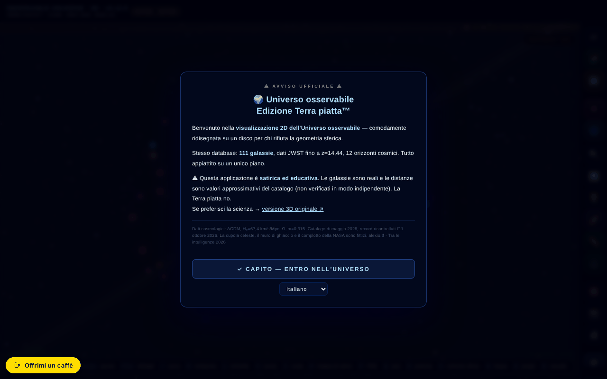

# Observable Universe 2D · v5.12.4 · Flat Earth Edition™

[English](README.md) · [Română](README.ro.md) · [Français](README.fr.md) · **Italiano** · [Español](README.es.md) · [Português](README.pt.md) · [Deutsch](README.de.md) · [Magyar](README.hu.md)

**Versione:** 5.12.7 · **Ultimo aggiornamento:** 2026-10-22

Lingue dell'interfaccia: **Română, English, Français, Italiano, Español, Português (PT), Deutsch, Magyar**

Mappa 2D interattiva dell'universo osservabile, in scala logaritmica, con 112 voci di catalogo (111 galassie + il fondo cosmico CMB) — in un'edizione satirica «Terra piatta».

**App online:** https://chiuta.github.io/Universul-Observabil-2D/

## Che cos'è

Un'applicazione a file singolo (`index.html`, canvas + JavaScript) che mostra l'universo osservabile come un disco piatto, in scala logaritmica, con 111 galassie (più il fondo CMB = 112 voci), orizzonti cosmici e dati JWST (il catalogo dell'applicazione è datato maggio 2026; record mostrato: MoM-z14, z=14,44, ricontrollato l'11 ottobre 2026). L'edizione «Terra piatta™» è umoristica/satirica, e l'applicazione include anche una sezione che smonta la teoria della Terra piatta e una sui limiti della simulazione.

## Funzionalità

- Navigazione: zoom (scroll, +/-), spostamento, reimpostazione della vista, annullamento della navigazione (Z), menu laterale.
- Livelli visivi (etichette, griglia, anelli, filamenti, mappa di calore, gruppi gravitazionali, modalità spettro ecc.), con correzioni per il daltonismo (deuteranopia, protanopia, tritanopia, acromatopsia).
- Righello (M): le galassie A e B si scelgono con un clic sulla mappa o per nome (campi con elenco, utilizzabili da tastiera), con il pulsante «Copia il risultato».
- Ricerca di galassie, galassia casuale, preferiti (con esportazione CSV), esportazione CSV delle 112 voci (111 galassie + CMB).
- Tour guidato, Quiz cosmico con classifica locale, «Potenze di 10», comparatore di scala, schermo diviso, simulazione di Andromeda, «Lo sapevi che…», strumento di misura, statistiche.
- Colonna sonora adattiva (Web Audio) con attivazione/disattivazione e volume.
- Esportazione PNG e stampa; permalink con lo stato completo (`#s=...`).
- Guida integrata: Intro, Navigazione, Livelli visivi, Cronologia dei record di distanza, Terra piatta, Glossario, Domande frequenti, Limiti della simulazione, Cronologia delle versioni, Crediti e fonti.
- Interfaccia in 8 lingue (RO, EN, FR, IT, ES, PT, DE, HU).
- **Lingue:** la guida (10 schede), le 112 descrizioni di galassie, i 25 «Lo sapevi?», le narrazioni del tour, le Potenze di dieci, i riferimenti della cronologia, la modalità insegnante, il messaggio dell'evento dell'8 maggio, le righe del poster A3 e le descrizioni nel quiz e nel comparatore sono disponibili nelle 8 lingue. Restano invariati: la cronologia delle versioni v5.8 e precedenti (in inglese; una nota nella guida lo segnala), il nome dell'app nell'intestazione, i nomi propri e le fonti. Le traduzioni sono automatiche; si consiglia una revisione da madrelingua.
- Le etichette che si sovrapporrebbero vengono omesse automaticamente (compaiono con uno zoom maggiore).

## Guida all'uso

1. Alla prima visita compare un breve tutorial; puoi saltarlo («Skip tutorial»).
2. Naviga: scroll per lo zoom, trascina per spostarti, **R** reimposta, **Z** torna alla posizione precedente.
3. Apri il menu ☰ o usa la barra superiore per Search, Tour, Quiz, Powers×10, Scale, Andromeda, Split Screen, Did you know, Measure, Favorites, Stats, Random, Export PNG.
4. Tasti: **/** ricerca, **R** reimpostazione, **L** etichette, **S** suono, **C** comparatore di scala, **H** mappa di calore, **P** esportazione PNG, **T** tour, **M** misura, **Q** quiz, **D** galassia casuale, **F** preferiti, **G** gruppi gravitazionali, **N** cambia lingua, **O** Powers of Ten, **X** schermo diviso, **A** simulazione di Andromeda, **Z** annulla la navigazione, **`** menu laterale, **?** elenco delle scorciatoie, **Esc** chiude i pannelli.
5. Lingua: il tasto **N** (scorre le lingue) o il menu della lingua nella barra.
6. Daltonismo: scegli la modalità dal pannello dei livelli (Normal, Deuteranopia, Protanopia, Tritanopia, Achromatopsia).
7. Salvataggio: stella ⭐ per i preferiti, «⬇ Export favorites CSV», «⬇ Export CSV (112 entries)» o «📸 Export PNG».

## Privacy e rete

- **Archiviazione locale:** `localStorage` — `uv_lang` (lingua), `uv2d_favs` (preferiti), `uv2d_prefs_v1` (preferenze: daltonismo, livelli, suono, volume), più i punteggi del quiz; `sessionStorage` — `tut_done`, `uv_eventGreetingShown`. L'applicazione afferma che nulla viene inviato a un server (non ha backend).
- **Service worker:** nel file esiste il codice per un service worker da blob, ma i browser rifiutano la registrazione di un service worker da `blob:`; in pratica è inattivo. L'applicazione funziona offline perché è un unico file locale, non grazie alla cache.
- **Rete:** non ho trovato chiamate `fetch` di dati verso servizi di terze parti. I link verso alexio.tf, ares.org.ro, Buy Me a Coffee, Wikipedia, ADS ed ESA Sky si aprono solo al clic. I meta tag (Open Graph, immagine di anteprima) puntano ad alexio.tf, senza effetto durante l'esecuzione.

## Nota: edizione satirica

L'edizione «Terra piatta™» è satirica. Gli elementi Volta Celeste, Muro di Ghiaccio, «Cospirazione NASA» e Tartaruga Spaziale sono fittizi; le galassie e le distanze sono quelle del catalogo. Oltre all'avviso all'apertura, la pagina mostra ora in modo permanente, nella barra superiore (anche su mobile), l'etichetta «SATIRĂ · SATIRE».

## Dati e fonti
Le affermazioni di «record» (MoM-z14, z = 14,44) sono valide **alla data del catalogo (maggio 2026), ricontrollate l'11 ottobre 2026**, e possono essere superate. Fonte: Naidu et al., arXiv:2505.11263 (preprint di maggio 2025; pubblicato sull'Open Journal of Astrophysics, gennaio 2026). La voce EGS-z11-R0 (marzo 2026, arXiv:2603.15841; riportata anche da phys.org, marzo 2026) non è stata verificata in modo indipendente nel dettaglio. Le distanze sono valori approssimativi dal catalogo dell'applicazione (ΛCDM, Planck 2018), a scopo educativo. Il riferimento di citazione non contiene più un DOI (l'applicazione non ne ha ancora uno). Bibliografia per galassia: in corso di completamento.

## Esecuzione locale / offline

Scarica `index.html` e aprilo in un browser; funziona senza internet. L'applicazione resta funzionale senza internet (il service worker da blob è inattivo).

## Cronologia / Changelog

### 5.12.7 — 2026-10-22
- fff-kit 1.1.4: bersagli touch e testo minimo; bersagli touch/testo corretti

### 5.12.6 — 2026-10-22
- fff-kit 1.1.2: PBKDF2 a 600.000 iterazioni, protezione anti-clickjacking.

### 5.12.5 — 2026-10-22
- Offline davvero: il service worker inline difettoso (URL blob:, che non può mai mettere in cache la pagina) è stato sostituito da un vero sw.js (cache first con rivalidazione in background), da un manifest web e da icone; l'app ora si apre senza rete dopo la prima visita e può essere installata. Anche il generatore di QR è precaricato in cache.
- Accessibilità: la pagina ha ora esattamente un H1 (la barra del titolo); il campo di ricerca per il confronto, il cursore della velocità della cronologia e i due cursori della vista divisa hanno un nome annunciato dagli screen reader (8 lingue); i cursori hanno aree tattili di 24 px.
- Le immagini PNG esportate riportano ora il marchio «PARODIA · Edizione Terra piatta™ — la Terra non è piatta» (nella lingua dell'interfaccia), così che un'immagine non possa essere citata fuori contesto.
- Mobile: tutto il testo dell'interfaccia è di almeno 12 px.

- 5.12.4 — 2026-10-22: i restanti nomi rumeni di galassie (Via Lattea, Triangolo, Sigaro, Girandola, Vortice, Ago, Occhio nero, Girasole, Antenne, Fuochi d'artificio, Proiettile, Fenice, Lente, Nana del Cane Maggiore, Orizzonte CMB, ecc.) e le etichette dei gruppi gravitazionali sulla mappa sono tradotti in tutte e 8 le lingue; le chiavi interne restano invariate.
- 5.12.3 — 2026-10-22: le etichette delle due Nubi di Magellano (LMC/SMC) sono tradotte in tutte e 8 le lingue (acronimi mantenuti); il titolo della barra superiore (UNIVERSO OSSERVABILE · 2D) e quello dell'esportazione PNG seguono la lingua dell'interfaccia; l'etichetta di satira non ripete più la parola in fr/it/es/pt/de/hu.
- 5.12.2 — 2026-10-22: l'interfaccia è ora completa anche in rumeno e inglese (barra laterale, scorciatoie, ticker, tooltip e aria-label non mescolano più le due lingue); titolo della pagina e meta-descrizioni seguono la lingua dell'interfaccia.

### 5.12.1 — 2026-10-19
- La guida, le descrizioni delle galassie, i «Lo sapevi?», il tour, le Potenze di dieci, i riferimenti della cronologia, la modalità insegnante e il poster A3 sono tradotti in fr, it, es, pt, de, hu; l'affermazione falsa che «restano in ro/en» è stata corretta.

### 5.11.0 — 2026-10-19
- Pulsante «📏 ASSE 1D ↗» nel pannello della galassia (stessa galassia, lingua corrente); il permalink `#g=` accetta la guardia `gn`.

### 5.10.0 — 2026-10-14
- Backup ed etichettatura dei dati (fff-kit).

### 12 ottobre 2026 — versione 5.9.4
- 5.9.4 — 2026-10-12: la versione e la data dell'ultimo aggiornamento sono mostrate nell'app

### 11 ottobre 2026 (terzo passaggio) — versione 5.9.3
- Righello: corrispondenza parziale del nome (all'Invio/all'uscita dal campo) con un messaggio chiaro quando non c'è corrispondenza o ce ne sono più di una.
- Il widget di sostegno si nasconde finché è visualizzato l'avviso iniziale (a 360 px copriva il pulsante RO/EN). CSP: hash ricalcolato.

### 11 ottobre 2026 (secondo passaggio) — versione 5.9.2
- Righello: scelta delle galassie A/B per nome (senza clic sulla mappa) e «Copia il risultato»; i testi ora indicano «111 galassie» (+ CMB = 112 voci) invece di «112 galassie»; cronologia RO/EN nella guida; CSP: hash ricalcolato.

### 11 ottobre 2026
- Versione 5.9.1 (titolo, meta, JSON-LD, `VERSION`, cache SW, guida integrata — cronologia RO/EN).
- Corretto un commento che conteneva letteralmente la chiusura del tag script: ~3 KB di codice (stato dei pulsanti della barra mobile, focus trap per il cassetto) comparivano come testo nella pagina e non venivano eseguiti; lo stesso difetto causava lo scorrimento orizzontale a 360 px.
- Il righello e il tocco su mobile trovano la galassia nel punto premuto; etichette senza sovrapposizione; la pillola Buy Me a Coffee non copre più la barra mobile.
- Accessibilità: `<main>`, finestra di dialogo per l'avviso, navigazione per il cassetto, ticker come regione; axe-core 0 violazioni a 1280 e 360 px.
- Sicurezza: i 87 attributi `on*` inline sono stati sostituiti con gestori delegati (`data-onclick` ecc., interpretati senza `eval`); la CSP usa un hash SHA-256 per lo script, senza `'unsafe-inline'` in `script-src`.
- Il piè di pagina mostrava «111 galassie» contro «112» altrove: ora «112 voci (111 galassie + CMB)».

**Fonti verificate l'11.10.2026:** Wikipedia — List of the most distant astronomical objects (MoM-z14, z=14,44, l'attuale record spettroscopico; i candidati con z fotometrico più alto restano non confermati); phys.org, 2026-03 (EGS-z11-R0, z≈11,45).

## Licenza

MIT — vedi il file LICENSE

## Audit

Audit: 2026-10-10 — l'unico `fetch` nel file si trova nel service worker da blob (cache GET, stessa origine; CSP `connect-src 'self'`); non ci sono chiamate di dati verso terze parti. La satira è segnalata esplicitamente alla prima apertura («satirical and educational… The flat Earth is not»). I dati del catalogo (incluso il record JWST MoM-z14, z=14,44) provengono dai contenuti dell'autore e non sono stati verificati in modo indipendente in questo audit. Correzioni di accessibilità: viewport (zoom consentito), etichette per i cursori di filtro.

## Diritti e attribuzione
L'applicazione e il codice appartengono all'autore (licenza MIT, vedi `LICENSE`). I dati astronomici provengono da pubblicazioni e cataloghi pubblici; i diritti sui materiali di terzi appartengono ai rispettivi titolari e la licenza MIT non li copre. Se sei titolare di diritti o una persona menzionata e desideri una correzione o un ritiro, scrivi a alexio@trom.tf; rispondiamo entro 7 giorni.

## Autore

Alexio — Alexandru-Ionuț Chiuță, contatto: alexio@trom.tf. L'applicazione accredita l'autore insieme ad ARES (ares.org.ro) e al Centrul StrING.

## Riepilogo
Una mappa 2D interattiva dell'universo osservabile a file singolo, in scala logaritmica, con 111 galassie (più il fondo CMB = 112 voci), dati JWST (catalogo datato maggio 2026), tour, quiz con classifica locale, Potenze di 10, schermo diviso, simulazione di Andromeda, modalità per daltonici, esportazione CSV/PNG e una «Flat Earth Edition» satirica con guida integrata. 8 lingue. Preferenze memorizzate in localStorage; nessuna richiesta di dati a terze parti. Licenza MIT.

Turno 3: 2026-10-11 — formulazioni «alla data del catalogo», DOI fittizio rimosso dalla guida, etichette bilingui per i cursori di filtro.
