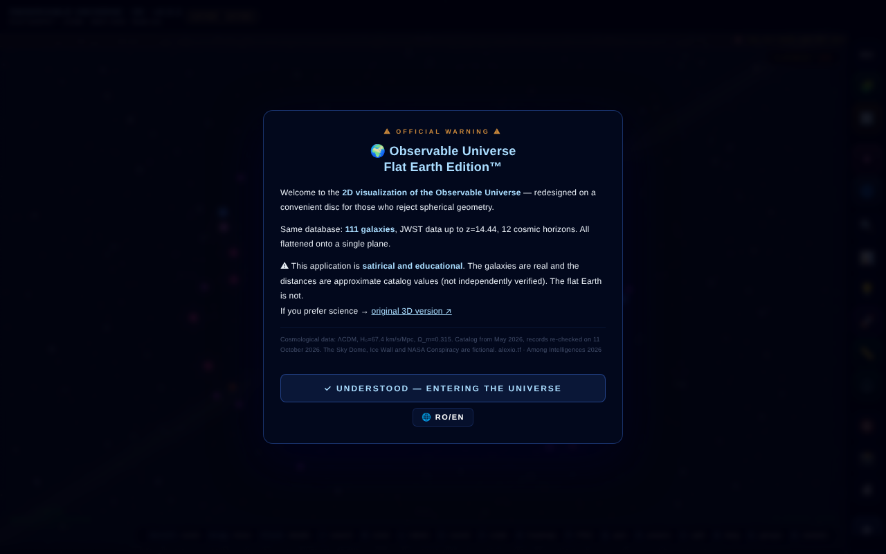

# Observable Universe 2D · v5.9.4 · Flat Earth Edition™

**Versiune:** 5.10.0 · **Ultima actualizare:** 14 octombrie 2026

Harta 2D interactivă a universului observabil, pe scară logaritmică, cu 112 intrări de catalog (111 galaxii + fundalul cosmic CMB) — în ediție satirică „Pământ Plat”.

**Live:** https://chiuta.github.io/Universul-Observabil-2D/

## Ce este

O aplicație single-file (`index.html`, canvas + JavaScript) care afișează universul observabil ca disc plat, pe scară logaritmică, cu 111 galaxii (plus fundalul CMB = 112 intrări), orizonturi cosmice și date JWST (catalogul din aplicație este datat mai 2026; recordul afișat: MoM-z14, z=14.44, reverificat la 11 octombrie 2026). Ediția „Pământ Plat™” este umoristică/satirică, iar aplicația include și o secțiune care demontează teoria Pământului plat și una despre limitele simulării.

## Funcții

- Navigare: zoom (scroll, +/-), deplasare, reset vizualizare, anulare navigare (Z), meniu lateral.
- Straturi vizuale (etichete, grilă, inele, filamente, heatmap, grupuri gravitaționale, mod spectru etc.), cu corecții pentru daltonism (deuteranopie, protanopie, tritanopie, acromatopsie).
- Riglă (M): galaxiile A și B se aleg cu clic pe hartă sau după nume (câmpuri cu listă, utilizabile de la tastatură), cu buton „Copiază rezultatul”.
- Căutare galaxie, galaxie aleatoare, favorite (cu export CSV), export CSV al celor 112 intrări (111 galaxii + CMB).
- Tur ghidat, Quiz cosmic cu clasament local, „Puterile lui 10”, comparator de scară, ecran împărțit, simulare Andromeda, „Știai că…”, instrument de măsurare, statistici.
- Coloană sonoră adaptivă (Web Audio) cu activare/dezactivare și volum.
- Export PNG și imprimare; permalink cu starea completă (`#s=...`).
- Ghid integrat: Intro, Navigare, Straturi vizuale, Cronologia recordurilor de distanță, Pământ plat, Glosar, Întrebări frecvente, Limitele simulării, Istoric versiuni, Credite și surse.
- Interfață bilingvă română / engleză.
- Etichetele care s-ar suprapune sunt omise automat (apar la zoom mai mare).

## Manual de utilizare

1. La prima vizită apare un tutorial scurt; îl poți omite („Skip tutorial”).
2. Navighează: scroll pentru zoom, trage pentru deplasare, **R** resetează, **Z** revine la poziția anterioară.
3. Deschide meniul ☰ sau folosește bara de sus pentru Căutare, Tur, Quiz, Powers×10, Scale, Andromeda, Split Screen, Did you know, Measure, Favorites, Stats, Random, Export PNG.
4. Taste: **/** căutare, **R** reset, **L** etichete, **S** sunet, **C** comparator de scară, **H** heatmap, **P** export PNG, **T** tur, **M** măsurare, **Q** quiz, **D** galaxie aleatoare, **F** favorite, **G** grupuri gravitaționale, **N** schimbă limba, **O** Powers of Ten, **X** ecran împărțit, **A** simulare Andromeda, **Z** anulează navigarea, **`** meniu lateral, **?** lista scurtăturilor, **Esc** închide panourile.
5. Limba: tasta **N** sau butonul RO/EN.
6. Daltonism: alege modul din panoul de straturi (Normal, Deuteranopia, Protanopia, Tritanopia, Achromatopsia).
7. Salvare: stea ⭐ pentru favorite, „⬇ Export favorites CSV”, „⬇ Export CSV (112 entries)” sau „📸 Export PNG”.

## Confidențialitate și rețea

- **Stocare locală:** `localStorage` — `uv_lang` (limba), `uv2d_favs` (favorite), `uv2d_prefs_v1` (preferințe: daltonism, straturi, sunet, volum), plus scorurile quiz-ului; `sessionStorage` — `tut_done`, `uv_eventGreetingShown`. Aplicația afirmă că nimic nu este trimis unui server (nu are backend).
- **Service worker:** codul pentru un service worker din blob există în fișier, dar browserele resping înregistrarea unui service worker din `blob:`; în practică este inactiv. Aplicația funcționează offline pentru că este un singur fișier local, nu datorită cache-ului.
- **Rețea:** nu am găsit apeluri `fetch` de date către servicii terțe. Linkurile către alexio.tf, ares.org.ro, Patreon, Buy Me a Coffee, Wikipedia, ADS și ESA Sky se deschid doar la click. Meta-etichetele (Open Graph, imagine de previzualizare) indică alexio.tf, fără efect la rulare.

## Notă: ediție satirică

Ediția „Pământ Plat™” este satirică. Elementele Bolta Cerească, Zidul de Gheață, „Conspirația NASA" și Broasca Țestoasă Spațială sunt fictive; galaxiile și distanțele sunt cele din catalog. Pe lângă avertismentul de la deschidere, pagina afișează acum permanent, în bara de sus (inclusiv pe mobil), eticheta „SATIRĂ · SATIRE".

## Date și surse
Afirmațiile „record” (MoM-z14, z = 14,44) sunt valabile **la data catalogului (mai 2026), reverificate la 11 octombrie 2026**, și pot fi depășite. Sursă: Naidu et al., arXiv:2505.11263 (preprint mai 2025; publicat în Open Journal of Astrophysics, ianuarie 2026). Intrarea EGS-z11-R0 (martie 2026, arXiv:2603.15841; raportată și de phys.org, martie 2026) nu a fost verificată independent în detaliu. Distanțele sunt valori aproximative din catalogul aplicației (ΛCDM, Planck 2018), cu scop educațional. Referința de citare nu mai conține un DOI (aplicația nu are încă unul). Bibliografie per galaxie: în curs de completare.

## Rulare locală / offline

Descarcă `index.html` și deschide-l în browser; funcționează fără internet. Aplicația rămâne funcțională fără internet (service worker-ul din blob este inactiv).

## Istoric / Changelog

### 5.10.0 — 2026-10-14
- Copie de rezervă și etichetare date (fff-kit).

### 12 octombrie 2026 — versiunea 5.9.4
- 5.9.4 — 2026-10-12: versiunea și data ultimei actualizări sunt afișate în aplicație

### 11 octombrie 2026 (a treia trecere) — versiunea 5.9.3
- Rigla: potrivire parțială a numelui (la Enter/ieșire din câmp) cu mesaj clar când nu există sau sunt mai multe potriviri.
- Widgetul de sprijin se ascunde cât timp e afișat avertismentul inițial (pe 360 px acoperea butonul RO/EN). CSP: hash recalculat.

### 11 octombrie 2026 (a doua trecere) — versiunea 5.9.2
- Rigla: alegerea galaxiilor A/B după nume (fără clic pe hartă) și „Copiază rezultatul”; textele afirmă acum „111 galaxii” (+ CMB = 112 intrări) în loc de „112 galaxii”; istoric RO/EN în ghid; CSP: hash recalculat.

### 11 octombrie 2026
- Versiune 5.9.1 (titlu, meta, JSON-LD, `VERSION`, cache SW, ghid integrat — istoric RO/EN).
- Reparat un comentariu care conținea literal închiderea tagului de script: ~3 KB de cod (starea butoanelor din bara mobilă, focus trap pentru sertar) apăreau ca text în pagină și nu rulau; același defect producea defilare orizontală la 360 px.
- Rigla și atingerea pe mobil găsesc galaxia din punctul apăsat; etichetele fără suprapunere; pastila Patreon/Coffee nu mai acoperă bara mobilă.
- Accesibilitate: `<main>`, dialog pentru avertisment, navigare pentru sertar, ticker ca regiune; axe-core 0 încălcări la 1280 și 360 px.
- Securitate: cele 87 de atribute `on*` inline au fost înlocuite cu handler-e delegate (`data-onclick` etc., interpretate fără `eval`); CSP folosește hash SHA-256 pentru script, fără `'unsafe-inline'` în `script-src`.
- Subsolul afișa „111 galaxies” față de „112” în rest: acum „112 entries (111 galaxies + CMB)”.

**Surse verificate la 11.10.2026:** Wikipedia — List of the most distant astronomical objects (MoM-z14, z=14,44, recordul spectroscopic curent; candidații cu z fotometric mai mare rămân neconfirmați); phys.org, 2026-03 (EGS-z11-R0, z≈11,45).

## Licență

CC0 1.0 Universal (domeniu public) — vezi fișierul LICENSE

## Audit

Audit: 2026-10-10 — singurul `fetch` din fișier este în service worker-ul din blob (cache GET, same-origin; CSP `connect-src 'self'`); nu există apeluri de date către terți. Satira este semnalată explicit la prima deschidere („satirical and educational… The flat Earth is not"). Datele din catalog (inclusiv recordul JWST MoM-z14, z=14.44) provin din conținutul autorului și nu au fost verificate independent în acest audit. Corecturi de accesibilitate: viewport (zoom permis), etichete pentru sliderele de filtrare.

## Drepturi și atribuire
Aplicația și codul aparțin autorului (CC0 1.0, vezi `LICENSE`). Datele astronomice provin din publicații și cataloage publice; drepturile asupra materialelor terțe aparțin titularilor, iar dedicarea CC0 nu le acoperă. Dacă ești titular de drepturi sau persoană menționată și dorești corectarea sau retragerea, scrie la alexio@trom.tf; răspundem în 7 zile.

## Autor

Alexio — Alexandru-Ionuț Chiuță, contact: alexio@trom.tf. Aplicația îl creditează pe autor împreună cu ARES (ares.org.ro) și Centrul StrING.

## English summary

A single-file interactive 2D map of the observable universe on a logarithmic scale with 111 galaxies (plus the CMB background = 112 entries), JWST data (catalog dated May 2026), tour, quiz with local leaderboard, Powers of Ten, split screen, Andromeda simulation, colour-blind modes, CSV/PNG export and a satirical "Flat Earth Edition" with a built-in guide. Bilingual RO/EN. Preferences stored in localStorage; no data requests to third parties. CC0.

Rundă 3: 2026-10-11 — formulări „la data catalogului”, DOI-ul placeholder eliminat din ghid, etichete bilingve pentru sliderele de filtrare.
