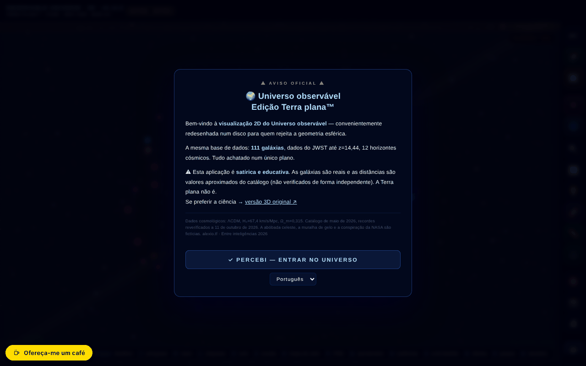

# Observable Universe 2D · v5.12.4 · Flat Earth Edition™

[English](README.md) · [Română](README.ro.md) · [Français](README.fr.md) · [Italiano](README.it.md) · [Español](README.es.md) · **Português** · [Deutsch](README.de.md) · [Magyar](README.hu.md)

**Versão:** 5.12.8 · **Última atualização:** 2026-10-23

Idiomas da interface: **Română, English, Français, Italiano, Español, Português (PT), Deutsch, Magyar**

Mapa 2D interativo do universo observável, em escala logarítmica, com 112 entradas de catálogo (111 galáxias + o fundo cósmico CMB) — numa edição satírica «Terra Plana».

**Aplicação online:** https://chiuta.github.io/Universul-Observabil-2D/

## O que é

Uma aplicação de ficheiro único (`index.html`, canvas + JavaScript) que apresenta o universo observável como um disco plano, em escala logarítmica, com 111 galáxias (mais o fundo CMB = 112 entradas), horizontes cósmicos e dados do JWST (o catálogo da aplicação está datado de maio de 2026; recorde apresentado: MoM-z14, z=14,44, reverificado a 11 de outubro de 2026). A edição «Terra Plana™» é humorística/satírica, e a aplicação inclui também uma secção que desmonta a teoria da Terra plana e outra sobre os limites da simulação.

## Funcionalidades

- Navegação: zoom (scroll, +/-), deslocação, reposição da vista, anular navegação (Z), menu lateral.
- Camadas visuais (etiquetas, grelha, anéis, filamentos, mapa de calor, grupos gravitacionais, modo espectro, etc.), com correções para o daltonismo (deuteranopia, protanopia, tritanopia, acromatopsia).
- Régua (M): as galáxias A e B escolhem-se com um clique no mapa ou pelo nome (campos com lista, utilizáveis com o teclado), com um botão «Copiar o resultado».
- Pesquisa de galáxias, galáxia aleatória, favoritos (com exportação CSV), exportação CSV das 112 entradas (111 galáxias + CMB).
- Visita guiada, Questionário cósmico com classificação local, «Potências de 10», comparador de escala, ecrã dividido, simulação de Andrómeda, «Sabia que…», ferramenta de medição, estatísticas.
- Banda sonora adaptativa (Web Audio) com ativação/desativação e volume.
- Exportação PNG e impressão; permalink com o estado completo (`#s=...`).
- Guia integrado: Intro, Navegação, Camadas visuais, Cronologia dos recordes de distância, Terra plana, Glossário, Perguntas frequentes, Limites da simulação, Histórico de versões, Créditos e fontes.
- Interface em 8 idiomas (RO, EN, FR, IT, ES, PT, DE, HU).
- **Idiomas:** o guia (10 fichas), as 112 descrições de galáxias, os 25 «Sabias que?», as narrações da visita, as Potências de dez, os marcos da cronologia, o modo professor, a mensagem do evento de 8 de maio, as linhas do póster A3 e as descrições no questionário e no comparador estão disponíveis nos 8 idiomas. Permanecem inalterados: o histórico de versões v5.8 e anteriores (em inglês; uma nota no guia indica-o), o nome da aplicação no cabeçalho, os nomes próprios e as fontes. As traduções são automáticas; recomenda-se revisão nativa.
- As etiquetas que se sobreporiam são omitidas automaticamente (aparecem com um zoom maior).

## Manual de utilização

1. Na primeira visita aparece um breve tutorial; pode omiti-lo («Skip tutorial»).
2. Navegue: scroll para o zoom, arraste para deslocar, **R** repõe, **Z** volta à posição anterior.
3. Abra o menu ☰ ou use a barra superior para Search, Tour, Quiz, Powers×10, Scale, Andromeda, Split Screen, Did you know, Measure, Favorites, Stats, Random, Export PNG.
4. Teclas: **/** pesquisa, **R** repor, **L** etiquetas, **S** som, **C** comparador de escala, **H** mapa de calor, **P** exportar PNG, **T** visita, **M** medição, **Q** questionário, **D** galáxia aleatória, **F** favoritos, **G** grupos gravitacionais, **N** mudar de língua, **O** Powers of Ten, **X** ecrã dividido, **A** simulação de Andrómeda, **Z** anular a navegação, **`** menu lateral, **?** lista de atalhos, **Esc** fecha os painéis.
5. Língua: a tecla **N** (percorre as línguas) ou o menu de língua na barra.
6. Daltonismo: escolha o modo no painel de camadas (Normal, Deuteranopia, Protanopia, Tritanopia, Achromatopsia).
7. Gravação: estrela ⭐ para favoritos, «⬇ Export favorites CSV», «⬇ Export CSV (112 entries)» ou «📸 Export PNG».

## Privacidade e rede

- **Armazenamento local:** `localStorage` — `uv_lang` (língua), `uv2d_favs` (favoritos), `uv2d_prefs_v1` (preferências: daltonismo, camadas, som, volume), além das pontuações do questionário; `sessionStorage` — `tut_done`, `uv_eventGreetingShown`. A aplicação afirma que nada é enviado a um servidor (não tem backend).
- **Service worker:** no ficheiro existe o código de um service worker a partir de um blob, mas os navegadores rejeitam o registo de um service worker a partir de `blob:`; na prática está inativo. A aplicação funciona offline porque é um único ficheiro local, não graças a uma cache.
- **Rede:** não encontrei chamadas `fetch` de dados a serviços de terceiros. As ligações para alexio.tf, ares.org.ro, Buy Me a Coffee, Wikipédia, ADS e ESA Sky só se abrem ao clicar. As metaetiquetas (Open Graph, imagem de pré-visualização) apontam para alexio.tf, sem efeito na execução.

## Nota: edição satírica

A edição «Terra Plana™» é satírica. Os elementos Abóbada Celeste, Muro de Gelo, «Conspiração da NASA» e Tartaruga Espacial são fictícios; as galáxias e as distâncias são as do catálogo. Além do aviso à abertura, a página apresenta agora de forma permanente, na barra superior (inclusive em telemóvel), a etiqueta «SATIRĂ · SATIRE».

## Dados e fontes
As afirmações de «recorde» (MoM-z14, z = 14,44) são válidas **à data do catálogo (maio de 2026), reverificadas a 11 de outubro de 2026**, e podem ser ultrapassadas. Fonte: Naidu et al., arXiv:2505.11263 (pré-publicação de maio de 2025; publicado no Open Journal of Astrophysics, janeiro de 2026). A entrada EGS-z11-R0 (março de 2026, arXiv:2603.15841; noticiada também pela phys.org, março de 2026) não foi verificada de forma independente em detalhe. As distâncias são valores aproximados do catálogo da aplicação (ΛCDM, Planck 2018), com fins educativos. A referência de citação já não contém um DOI (a aplicação ainda não tem um). Bibliografia por galáxia: em curso de elaboração.

## Execução local / offline

Transfira `index.html` e abra-o num navegador; funciona sem internet. A aplicação continua funcional sem internet (o service worker a partir de blob está inativo).

## Histórico / Changelog

### 5.12.7 — 2026-10-22
- fff-kit 1.1.4: alvos táteis e texto mínimo; alvos táteis/texto corrigidos

### 5.12.6 — 2026-10-22
- fff-kit 1.1.2: PBKDF2 com 600.000 iterações, proteção anti-clickjacking.

### 5.12.5 — 2026-10-22
- Offline a sério: o service worker embutido defeituoso (URL blob:, que nunca consegue guardar a página em cache) foi substituído por um sw.js real (cache primeiro com revalidação em segundo plano), um manifesto web e ícones; a aplicação abre agora sem rede após a primeira visita e pode ser instalada. O gerador de QR também fica pré-carregado em cache.
- Acessibilidade: a página tem agora exatamente um H1 (a barra de título); o campo de pesquisa de comparação, o controlo da velocidade da cronologia e os dois controlos da vista dividida têm um nome anunciado pelos leitores de ecrã (8 idiomas); os controlos deslizantes têm áreas táteis de 24 px.
- As capturas PNG exportadas trazem agora a marca «PARÓDIA · Edição Terra plana™ — a Terra não é plana» (no idioma da interface), para que uma captura não possa ser citada fora de contexto.
- Móvel: todo o texto da interface tem pelo menos 12 px.

- 5.12.4 — 2026-10-22: os restantes nomes romenos de galáxias (Via Láctea, Triângulo, Charuto, Cata-vento, Redemoinho, Agulha, Olho Negro, Girassol, Antenas, Fogo de artifício, Bala, Fénix, Lente, Anã do Cão Maior, Horizonte CMB, etc.) e os rótulos dos grupos gravitacionais no mapa estão traduzidos nas 8 línguas; as chaves internas não mudam.
- 5.12.3 — 2026-10-22: os rótulos das duas Nuvens de Magalhães (LMC/SMC) estão traduzidos nas 8 línguas (siglas mantidas); o título da barra superior (UNIVERSO OBSERVÁVEL · 2D) e o da exportação PNG seguem a língua da interface; a etiqueta de sátira já não repete a palavra em fr/it/es/pt/de/hu.
- 5.12.2 — 2026-10-22: a interface está agora completa também em romeno e inglês (barra lateral, atalhos, faixa de notícias, dicas e aria-label já não misturam as duas línguas); o título da página e as metadescrições acompanham o idioma da interface.

### 5.12.1 — 2026-10-19
- O guia, as descrições de galáxias, os «Sabias que?», a visita, as Potências de dez, os marcos da cronologia, o modo professor e o póster A3 estão traduzidos para fr, it, es, pt, de, hu; foi corrigida a afirmação falsa de que «permanecem em ro/en».

### 5.11.0 — 2026-10-19
- Botão «📏 EIXO 1D ↗» no painel da galáxia (a mesma galáxia, idioma atual); o permalink `#g=` aceita a guarda `gn`.

### 5.10.0 — 2026-10-14
- Cópia de segurança e etiquetagem de dados (fff-kit).

### 12 de outubro de 2026 — versão 5.9.4
- 5.9.4 — 2026-10-12: a versão e a data da última atualização são apresentadas na aplicação

### 11 de outubro de 2026 (terceira passagem) — versão 5.9.3
- Régua: correspondência parcial do nome (ao premir Enter/sair do campo) com uma mensagem clara quando não há correspondência ou há várias.
- O widget de apoio esconde-se enquanto o aviso inicial é apresentado (a 360 px tapava o botão RO/EN). CSP: hash recalculado.

### 11 de outubro de 2026 (segunda passagem) — versão 5.9.2
- Régua: escolha das galáxias A/B pelo nome (sem clicar no mapa) e «Copiar o resultado»; os textos indicam agora «111 galáxias» (+ CMB = 112 entradas) em vez de «112 galáxias»; histórico RO/EN no guia; CSP: hash recalculado.

### 11 de outubro de 2026
- Versão 5.9.1 (título, meta, JSON-LD, `VERSION`, cache do SW, guia integrado — histórico RO/EN).
- Corrigido um comentário que continha literalmente o fecho da etiqueta script: ~3 KB de código (estado dos botões da barra móvel, armadilha de foco para a gaveta) apareciam como texto na página e não eram executados; o mesmo defeito causava deslocação horizontal a 360 px.
- A régua e o toque em telemóvel encontram a galáxia no ponto premido; etiquetas sem sobreposição; a pílula Buy Me a Coffee já não tapa a barra móvel.
- Acessibilidade: `<main>`, diálogo para o aviso, navegação para a gaveta, ticker como região; axe-core 0 violações a 1280 e 360 px.
- Segurança: os 87 atributos `on*` em linha foram substituídos por manipuladores delegados (`data-onclick`, etc., interpretados sem `eval`); a CSP usa um hash SHA-256 para o script, sem `'unsafe-inline'` em `script-src`.
- O rodapé mostrava «111 galáxias» contra «112» no resto: agora «112 entradas (111 galáxias + CMB)».

**Fontes verificadas a 11.10.2026:** Wikipédia — List of the most distant astronomical objects (MoM-z14, z=14,44, o atual recorde espectroscópico; os candidatos com z fotométrico superior continuam por confirmar); phys.org, 2026-03 (EGS-z11-R0, z≈11,45).

## Licença

MIT — veja o ficheiro LICENSE

## Auditoria

Auditoria: 2026-10-10 — o único `fetch` do ficheiro está no service worker a partir de blob (cache GET, mesma origem; CSP `connect-src 'self'`); não há chamadas de dados a terceiros. A sátira é assinalada explicitamente na primeira abertura («satirical and educational… The flat Earth is not»). Os dados do catálogo (incluindo o recorde do JWST MoM-z14, z=14,44) provêm do conteúdo do autor e não foram verificados de forma independente nesta auditoria. Correções de acessibilidade: viewport (zoom permitido), etiquetas para os cursores de filtragem.

## Direitos e atribuição
A aplicação e o código pertencem ao autor (licença MIT, veja `LICENSE`). Os dados astronómicos provêm de publicações e catálogos públicos; os direitos sobre materiais de terceiros pertencem aos respetivos titulares, e a licença MIT não os abrange. Se for titular de direitos ou pessoa mencionada e desejar uma correção ou retirada, escreva para alexio@trom.tf; respondemos em 7 dias.

## Autor

Alexio — Alexandru-Ionuț Chiuță, contacto: alexio@trom.tf. A aplicação credita o autor juntamente com a ARES (ares.org.ro) e o Centrul StrING.

## Resumo
Um mapa 2D interativo do universo observável num único ficheiro, em escala logarítmica, com 111 galáxias (mais o fundo CMB = 112 entradas), dados do JWST (catálogo datado de maio de 2026), visita guiada, questionário com classificação local, Potências de 10, ecrã dividido, simulação de Andrómeda, modos para daltónicos, exportação CSV/PNG e uma «Flat Earth Edition» satírica com guia integrado. 8 idiomas. Preferências guardadas em localStorage; sem pedidos de dados a terceiros. Licença MIT.

Ronda 3: 2026-10-11 — formulações «à data do catálogo», DOI fictício removido do guia, etiquetas bilingues para os cursores de filtragem.
