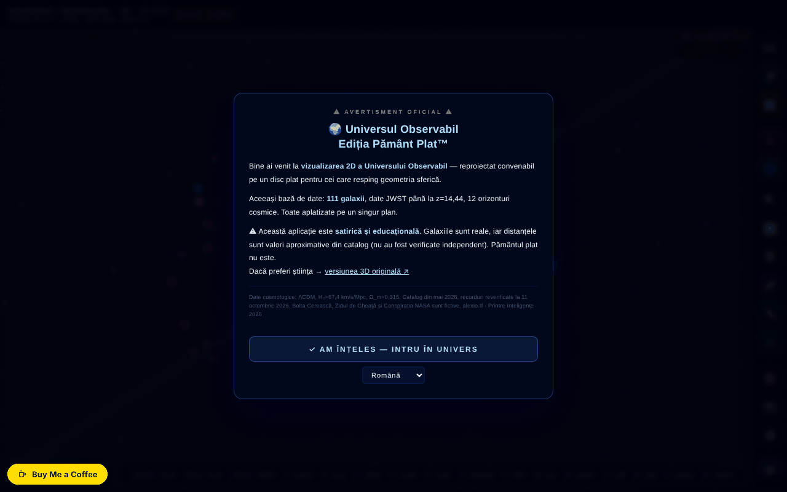

# Observable Universe 2D · v5.12.4 · Flat Earth Edition™

[English](README.md) · **Română** · [Français](README.fr.md) · [Italiano](README.it.md) · [Español](README.es.md) · [Português](README.pt.md) · [Deutsch](README.de.md) · [Magyar](README.hu.md)

**Versiune:** 6.2.1 · **Ultima actualizare:** 2026-10-28

**Stare:** stabil · **Offline:** complet

Limbile interfeței: **Română, English, Français, Italiano, Español, Português (PT), Deutsch, Magyar**

Harta 2D interactivă a universului observabil, pe scară logaritmică, cu 112 intrări de catalog (111 galaxii + fundalul cosmic CMB) — în ediție satirică „Pământ Plat”.

**Live:** https://chiuta.github.io/Universul-Observabil-2D/

## Ce este

O aplicație single-file (`index.html`, canvas + JavaScript) care afișează universul observabil ca disc plat, pe scară logaritmică, cu 111 galaxii (plus fundalul CMB = 112 intrări), orizonturi cosmice și date JWST (catalogul din aplicație este datat mai 2026; recordul afișat: MoM-z14, z=14.44, reverificat la 11 octombrie 2026). Ediția „Pământ Plat™” este umoristică/satirică, iar aplicația include și o secțiune care demontează teoria Pământului plat și una despre limitele simulării.

## Funcții

- Navigare: zoom (scroll, +/-), deplasare, reset vizualizare, anulare navigare (Z), meniu lateral.
- Straturi vizuale (etichete, grilă, inele, filamente, heatmap, grupuri gravitaționale, mod spectru etc.), cu corecții pentru daltonism (deuteranopie, protanopie, tritanopie, acromatopsie).
- Riglă (M): galaxiile A și B se aleg cu clic pe hartă sau după nume (câmpuri cu listă, utilizabile de la tastatură), cu buton „Copiază rezultatul”.
- Căutare galaxie, galaxie aleatoare, favorite (cu export CSV), export CSV al celor 112 intrări (111 galaxii + CMB).
- Tur ghidat, Quiz cosmic cu clasament local, „Puterile lui 10”, comparator de scară, ecran împărțit, simulare Andromeda, „Știai că…”, instrument de măsurare, statistici.
- Coloană sonoră adaptivă (Web Audio) cu activare/dezactivare și volum.
- Export PNG și imprimare; permalink cu starea completă (`#s=...`).
- Ghid integrat: Intro, Navigare, Straturi vizuale, Cronologia recordurilor de distanță, Pământ plat, Glosar, Întrebări frecvente, Limitele simulării, Istoric versiuni, Credite și surse.
- Interfață în 8 limbi (RO, EN, FR, IT, ES, PT, DE, HU).
- **Limbi:** ghidul (10 file), cele 112 descrieri de galaxii, cele 25 de „Știai că?”, narațiunile turului, Puterile lui zece, reperele cronologiei, modul profesor, mesajul evenimentului din 8 mai, liniile posterului A3 și descrierile din quiz și comparator sunt disponibile în cele 8 limbi. Rămân neschimbate: istoricul versiunilor v5.8 și mai vechi (păstrat în engleză; o notă din ghid o spune), numele aplicației din antet, numele proprii și sursele. Traducerile sunt automate; se recomandă revizie nativă.
- Etichetele care s-ar suprapune sunt omise automat (apar la zoom mai mare).

## Manual de utilizare

1. La prima vizită apare un tutorial scurt; îl poți omite („Skip tutorial”).
2. Navighează: scroll pentru zoom, trage pentru deplasare, **R** resetează, **Z** revine la poziția anterioară.
3. Deschide meniul ☰ sau folosește bara de sus pentru Căutare, Tur, Quiz, Powers×10, Scale, Andromeda, Split Screen, Did you know, Measure, Favorites, Stats, Random, Export PNG.
4. Taste: **/** căutare, **R** reset, **L** etichete, **S** sunet, **C** comparator de scară, **H** heatmap, **P** export PNG, **T** tur, **M** măsurare, **Q** quiz, **D** galaxie aleatoare, **F** favorite, **G** grupuri gravitaționale, **N** schimbă limba, **O** Powers of Ten, **X** ecran împărțit, **A** simulare Andromeda, **Z** anulează navigarea, **`** meniu lateral, **?** lista scurtăturilor, **Esc** închide panourile.
5. Limba: tasta **N** (parcurge limbile) sau meniul de limbă din bară.
6. Daltonism: alege modul din panoul de straturi (Normal, Deuteranopia, Protanopia, Tritanopia, Achromatopsia).
7. Salvare: stea ⭐ pentru favorite, „⬇ Export favorites CSV”, „⬇ Export CSV (112 entries)” sau „📸 Export PNG”.

## Confidențialitate și rețea

- **Stocare locală:** `localStorage` — `universul-observabil-2d.lang` (limba), `universul-observabil-2d.favs` (favorite), `universul-observabil-2d.prefs` (preferințe: daltonism, straturi, sunet, volum), plus scorurile quiz-ului; `sessionStorage` — `tut_done`, `uv_eventGreetingShown`. Aplicația afirmă că nimic nu este trimis unui server (nu are backend).
- **Service worker:** codul pentru un service worker din blob există în fișier, dar browserele resping înregistrarea unui service worker din `blob:`; în practică este inactiv. Aplicația funcționează offline pentru că este un singur fișier local, nu datorită cache-ului.
- **Rețea:** nu am găsit apeluri `fetch` de date către servicii terțe. Linkurile către alexio.tf, ares.org.ro, Buy Me a Coffee, Wikipedia, ADS și ESA Sky se deschid doar la click. Meta-etichetele (Open Graph, imagine de previzualizare) indică alexio.tf, fără efect la rulare.

## Notă: ediție satirică

**Comutator de ediție (v6.0):** butonul 🔬 din bara de sus comută între ediția satirică „Pământ Plat™” și o **ediție științifică**, în care dispar Bolta Cerească, Zidul de Gheață, NASA Secret HQ, Țestoasa Spațială, Indicele de Planeitate, ticker-ul, glumele și marcajul de parodie de pe exporturi. Fereastra de comutare explică fiecare corecție (7 puncte; textul întreg în română și engleză, titlurile și corecțiile pe scurt în toate cele 8 limbi). Alegerea se păstrează; `?ed=sci` / `?ed=sat` în adresă o impun. Datele astronomice sunt aceleași în ambele ediții.

Ediția „Pământ Plat™” este satirică. Elementele Bolta Cerească, Zidul de Gheață, „Conspirația NASA" și Broasca Țestoasă Spațială sunt fictive; galaxiile și distanțele sunt cele din catalog. Pe lângă avertismentul de la deschidere, pagina afișează acum permanent, în bara de sus (inclusiv pe mobil), eticheta „SATIRĂ · SATIRE".

**Banner permanent (6.1.0).** O bandă fixă „PĂMÂNT PLAT™ = SATIRĂ · FLAT EARTH™ = SATIRE” este acum mereu vizibilă în ediția satirică (nu poate fi închisă); Pământul este rotund, doar harta este plată. Este ascunsă în ediția științifică, unde nu există niciun element satiric.

## Date și surse
Afirmațiile „record” (MoM-z14, z = 14,44) sunt valabile **la data catalogului (mai 2026), reverificate la 11 octombrie 2026**, și pot fi depășite. Sursă: Naidu et al., arXiv:2505.11263 (preprint mai 2025; publicat în Open Journal of Astrophysics, ianuarie 2026). Intrarea EGS-z11-R0 (martie 2026, arXiv:2603.15841; raportată și de phys.org, martie 2026) nu a fost verificată independent în detaliu. Distanțele sunt valori aproximative din catalogul aplicației (ΛCDM, Planck 2018), cu scop educațional. Referința de citare nu mai conține un DOI (aplicația nu are încă unul). Bibliografie per galaxie: în curs de completare.

## Rulare locală / offline

Descarcă `index.html` și deschide-l în browser; funcționează fără internet. Aplicația rămâne funcțională fără internet (service worker-ul din blob este inactiv).

## Mărimea cataloagelor în serie (2.0.1)

- **Numere.** Hub: 112 intrări (copie identică a catalogului 1D). 1D: 112. 2D: 112 (111 galaxii + orizontul CMB; unele texte spun 111). 3D: 118 („peste 115” în descrieri). Cifrele diferă pentru că cataloagele sunt separate, nu dintr-o eroare de numărare.
- **Neunificate.** 3D are catalogul propriu, într-o structură diferită (RA în ore, alte nume și grafii), așa că numele se potrivesc doar parțial cu 1D/2D. Unificarea într-un singur fișier comun nu s-a făcut: fiecare aplicație este un singur fișier offline, fără pas de build comun, iar îmbinarea ar schimba datele în trei aplicații fără cum să fie validată aici. Semnalat autorului.
- **Conflict 1D ↔ 2D (rezolvat la 2026-10-28; surse și formule în `docs/DISCREPANTE.md` din hub).** Cele 8 distanțe (NGC 1132, IC 310, 3C 48, Abell 370, CL 0024+1654, SDSS J1004+4112, IC 4296, Abell 1689) urmează acum aceeași convenție în ambele aplicații: d = lb = lookback(z), în Mly, ΛCDM plat Planck 2018 (H₀ = 67,4, Ωm = 0,315), cu z confirmat de cel puțin 2 surse; 2D a preluat valorile din 1D (330, 270, 4150, 4200, 4400, 10050, 180, 2330). Redshift-ul Andromedei (M31) este −0,001 în ambele (M31 este spre albastru, −301 km/s). Eticheta „Perseus (BCG IC 310)” a devenit „IC 310 (Perseus)”: IC 310 nu este cea mai strălucitoare galaxie a roiului (aceea este NGC 1275, intrare separată).

## Recorduri JWST reverificate (27.10.2026)

- **MoM-z14:** z = 14,44, încă cea mai îndepărtată galaxie confirmată spectroscopic (Naidu et al., arXiv:2505.11263; publicat în Open Journal of Astrophysics, ian. 2026).
- **JADES-GS-z14-0:** NIRSpec z = 14,32 (+0,08/−0,20) (Carniani et al. 2024, Nature); ALMA [OIII] 88 µm z = 14,1793 ± 0,0007 (Schouws et al. 2025, arXiv:2409.20549), compatibil. Catalogul păstrează valoarea NIRSpec; valoarea ALMA este menționată în descriere.
- **PAN-z14-1:** z = 13,53 (+0,05/−0,06), JWST/NIRSpec (Donnan et al., arXiv:2601.11515, ian. 2026): a patra ca distanță, nu un record. Nu a fost adăugată în catalog (coordonatele nu au fost verificate), doar menționată în nota MoM-z14.

## Note JWST în 8 limbi și discrepanțe (6.2.0)

- Notele JWST reverificate la 27.10.2026 (ALMA [OIII] 88 µm pentru JADES-GS-z14-0, z = 14,1793; PAN-z14-1 în nota MoM-z14) există acum și în fr/it/es/pt/de/hu, ca **traduceri automate marcate** în text; cheile de traducere nu au fost modificate (`tests/jwst-notes.test.mjs`).
- Discrepanțele față de 1D (8 distanțe, semnul z al Andromedei) sunt într-un tabel generat: [`docs/DISCREPANTE.md`](docs/DISCREPANTE.md). **Nicio valoare nu a fost aleasă** (NED/SIMBAD inaccesibile în sesiune); valorile 2D nu coincid cu lookback-ul calculat din z-ul din propriul catalog (cele 1D da) — observație aritmetică, **nu o sursă**.
- Unificarea cataloagelor într-un fișier comun: nu s-a făcut.

## Istoric / Changelog

### 6.2.1 — 2026-10-28
- Catalog aliniat la z și la surse: NGC 1132 1020→330, IC 310 780→270, 3C 48 5200→4150, Abell 370 5900→4200, CL 0024+1654 5500→4400, SDSS J1004+4112 7000→10050, IC 4296 130→180, Abell 1689 7200→2330 Mly; z-ul Andromedei este acum −0,001 (blueshift); eticheta „IC 310 (Perseus)”; teste `tests/catalog.test.mjs` și `tests/blueshift.test.mjs`.

### 6.2.0 — 2026-10-27
- Note JWST traduse automat în 6 limbi; `docs/DISCREPANTE.md`.

### 6.0.0 — 2026-10-26
- Comutator de ediție satirică ⇄ științifică, cu fiecare corecție explicată; exporturile (PNG, poster A3) poartă marcajul ediției active.

### 5.12.10 — 2026-10-23
- Robustețe: preferințele, favoritele și clasamentul quiz-ului corupte din `localStorage` sunt ignorate în loc să blocheze aplicația; linkurile #g=… cu valori extreme sau `%` invalid nu mai strică randarea (zoom/pan limitate); versiunea afișată în titlu și în Ghid este din nou cea reală.

### 5.12.9 — 2026-10-23
- fff-kit 1.2.0: cheile din browser poartă acum prefixul aplicației (`universul-observabil-2d.lang`, `.favs`, `.prefs`); cele vechi (`uv_lang`, `uv2d_favs`, `uv2d_prefs_v1`) sunt migrate automat la pornire, inclusiv după importul unei copii .fff.json vechi. Alternativa „copiază linkul” nu mai folosește fereastra nativă a browserului, ci un dialog accesibil, în limba interfeței.

### 5.12.7 — 2026-10-22
- fff-kit 1.1.4: ținte tactile și text minim; ținte tactile/text corectate

### 5.12.6 — 2026-10-22
- fff-kit 1.1.2: PBKDF2 600 000 de iterații, protecție anti-clickjacking.

### 5.12.5 — 2026-10-22
- Offline pe bune: service worker-ul inline defect (URL blob:, care nu poate memora niciodată pagina) a fost înlocuit cu un sw.js real (cache-first cu revalidare în fundal), plus manifest web și pictograme; aplicația se deschide acum fără rețea după prima vizită și poate fi instalată. Generatorul de QR este și el pre-memorat.
- Accesibilitate: pagina are acum exact un H1 (bara de titlu); câmpul de căutare pentru comparație, glisorul vitezei cronologiei și cele două glisoare ale vederii împărțite au nume anunțate de cititoarele de ecran (8 limbi); glisoarele au ținte tactile de 24 px.
- Capturile PNG exportate poartă acum marcajul „PARODIE · Ediția Pământ Plat™ — Pământul nu e plat” (în limba interfeței), astfel încât o captură să nu poată fi citată scoasă din context.
- Mobil: tot textul interfeței are cel puțin 12 px.

- 5.12.4 — 2026-10-22: restul numelor românești de galaxii (Calea Lactee, Triunghiul, Trabucul, Morișca, Vârtejul, Spirala-Ac, Ochiul Negru, Floarea-Soarelui, Antenele, Artificii, Glonț, Fenicul, Lentilă, Câinele Mare Pitic, Orizont CMB și altele) și etichetele grupurilor gravitaționale de pe hartă sunt traduse în toate cele 8 limbi; cheile interne rămân neschimbate.
- 5.12.3 — 2026-10-22: etichetele celor doi Nori Magellanic (LMC/SMC) sunt traduse în toate cele 8 limbi (acronimele rămân); titlul din bara de sus (UNIVERSUL OBSERVABIL · 2D) și titlul exportului PNG urmează limba interfeței; eticheta de satiră nu se mai repetă în fr/it/es/pt/de/hu.
- 5.12.2 — 2026-10-22: interfața este acum completă și în română și în engleză (bara laterală, scurtăturile, tickerul, tooltip-urile și aria-label-urile nu mai amestecă cele două limbi); titlul paginii și meta-descrierile urmează limba interfeței.

### 5.12.1 — 2026-10-19
- Ghidul, descrierile galaxiilor, „Știai că?”, turul, Puterile lui zece, reperele cronologiei, modul profesor și posterul A3 sunt traduse în fr, it, es, pt, de, hu; mențiunea falsă că acestea „rămân în ro/en” a fost corectată.

### 5.11.0 — 2026-10-19
- Buton „📏 AXA 1D ↗” în panoul galaxiei (aceeași galaxie, limba curentă); permalink-ul `#g=` acceptă garda `gn`.

### 5.10.0 — 2026-10-14
- Copie de rezervă și etichetare date (fff-kit).

### 12 octombrie 2026 — versiunea 5.9.4
- 5.9.4 — 2026-10-12: versiunea și data ultimei actualizări sunt afișate în aplicație

### 11 octombrie 2026 (a treia trecere) — versiunea 5.9.3
- Rigla: potrivire parțială a numelui (la Enter/ieșire din câmp) cu mesaj clar când nu există sau sunt mai multe potriviri.
- Widgetul de sprijin se ascunde cât timp e afișat avertismentul inițial (pe 360 px acoperea butonul RO/EN). CSP: hash recalculat.

### 11 octombrie 2026 (a doua trecere) — versiunea 5.9.2
- Rigla: alegerea galaxiilor A/B după nume (fără clic pe hartă) și „Copiază rezultatul”; textele afirmă acum „111 galaxii” (+ CMB = 112 intrări) în loc de „112 galaxii”; istoric RO/EN în ghid; CSP: hash recalculat.

### 11 octombrie 2026
- Versiune 5.9.1 (titlu, meta, JSON-LD, `VERSION`, cache SW, ghid integrat — istoric RO/EN).
- Reparat un comentariu care conținea literal închiderea tagului de script: ~3 KB de cod (starea butoanelor din bara mobilă, focus trap pentru sertar) apăreau ca text în pagină și nu rulau; același defect producea defilare orizontală la 360 px.
- Rigla și atingerea pe mobil găsesc galaxia din punctul apăsat; etichetele fără suprapunere; pastila Buy Me a Coffee nu mai acoperă bara mobilă.
- Accesibilitate: `<main>`, dialog pentru avertisment, navigare pentru sertar, ticker ca regiune; axe-core 0 încălcări la 1280 și 360 px.
- Securitate: cele 87 de atribute `on*` inline au fost înlocuite cu handler-e delegate (`data-onclick` etc., interpretate fără `eval`); CSP folosește hash SHA-256 pentru script, fără `'unsafe-inline'` în `script-src`.
- Subsolul afișa „111 galaxies” față de „112” în rest: acum „112 entries (111 galaxies + CMB)”.

**Surse verificate la 11.10.2026:** Wikipedia — List of the most distant astronomical objects (MoM-z14, z=14,44, recordul spectroscopic curent; candidații cu z fotometric mai mare rămân neconfirmați); phys.org, 2026-03 (EGS-z11-R0, z≈11,45).

## Licență

MIT — vezi fișierul LICENSE

## Audit

Audit: 2026-10-10 — singurul `fetch` din fișier este în service worker-ul din blob (cache GET, same-origin; CSP `connect-src 'self'`); nu există apeluri de date către terți. Satira este semnalată explicit la prima deschidere („satirical and educational… The flat Earth is not"). Datele din catalog (inclusiv recordul JWST MoM-z14, z=14.44) provin din conținutul autorului și nu au fost verificate independent în acest audit. Corecturi de accesibilitate: viewport (zoom permis), etichete pentru sliderele de filtrare.

## Drepturi și atribuire
Aplicația și codul aparțin autorului (licență MIT, vezi `LICENSE`). Datele astronomice provin din publicații și cataloage publice; drepturile asupra materialelor terțe aparțin titularilor, iar licența MIT nu le acoperă. Dacă ești titular de drepturi sau persoană menționată și dorești corectarea sau retragerea, scrie la alexio@trom.tf; răspundem în 7 zile.

## Autor

Alexio — Alexandru-Ionuț Chiuță, contact: alexio@trom.tf. Aplicația îl creditează pe autor împreună cu ARES (ares.org.ro) și Centrul StrING.

## Rezumat

O hartă 2D interactivă a universului observabil, într-un singur fișier, pe scară logaritmică, cu 111 galaxii (plus fundalul CMB = 112 intrări), date JWST (catalog din mai 2026), tur, test cu clasament local, Puteri ale lui Zece, ecran împărțit, simulare Andromeda, moduri pentru daltonism, export CSV/PNG și o „Ediție Pământ Plat” satirică, cu ghid integrat. 8 limbi. Preferințele se stochează în localStorage; fără cereri de date către terți. Licență MIT.

Rundă 3: 2026-10-11 — formulări „la data catalogului”, DOI-ul placeholder eliminat din ghid, etichete bilingve pentru sliderele de filtrare.
